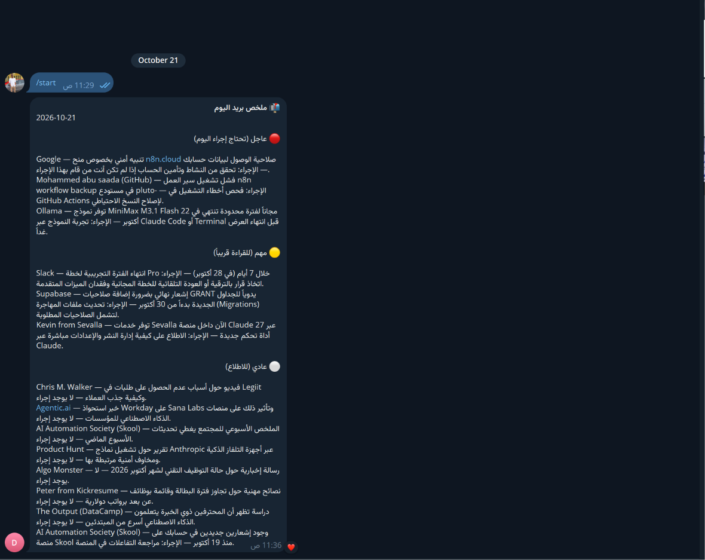

# ملخص Gmail اليومي إلى Telegram

Workflow لـ n8n يجمع الرسائل غير المقروءة من Gmail ويلخّصها بالعربية باستخدام Gemini، ثم يرسل ملخصًا واحدًا إلى Telegram. يعمل تلقائيًا كل يوم الساعة 08:00 حسب المنطقة الزمنية `Asia/Hebron`، ويرسل تنبيهًا بديلًا إذا لم يجد رسائل. يقسّم الملخص الطويل إلى رسائل تناسب حد Telegram.

## ماذا يفعل؟

1. يبدأ من الجدول اليومي أو من تشغيل يدوي.
2. يجلب حتى 20 رسالة غير مقروءة من آخر 24 ساعة، مع استبعاد فئتي Promotions وSocial.
3. ينظّف نص البريد من HTML والمحتوى غير الضروري.
4. يرسل النص إلى نموذج Gemini لإنشاء ملخص عربي مرتب حسب الأولوية.
5. يرسل النتيجة إلى Telegram؛ وإذا لم توجد رسائل، يرسل إشعارًا بذلك.

## المتطلبات

- n8n.
- حساب Gmail مع صلاحية OAuth2.
- بيانات اعتماد Google Gemini API.
- Telegram Bot وبيانات اعتماد Telegram Bot API.
- معرّف محادثة Telegram الذي سيستقبل الملخص.

## الإعداد

1. استورد [`workflow.json`](./workflow.json) إلى n8n.
2. اربط بيانات اعتماد Gmail وGemini وTelegram بعقد workflow.
3. افتح عقدة **Set Chat ID** وضع معرّف محادثتك في قيمة `chatId`.
4. تحقق من المنطقة الزمنية وموعد **Every Day at 08:00**، وعدّلها حسب حاجتك.
5. راجع إعدادات استعلام Gmail وحدّ الرسائل إذا أردت تغيير نطاق الملخص.

## التشغيل والاختبار

- للاختبار، شغّل **Test Manually** من محرر n8n.
- تأكد من وجود رسائل اختبار غير مقروءة في Gmail ومن وصول النتيجة إلى محادثة Telegram الصحيحة.
- بعد نجاح الاختبار، فعّل workflow للتشغيل المجدول.
- راجع تنفيذ العقد عند فشل الجلب أو التلخيص أو الإرسال؛ وتأكد من صلاحيات Gmail وGemini وTelegram.

## الصور

لقطة من تركيب workflow داخل n8n:

مثال للملخص الذي يصل إلى Telegram:

## الملفات

- [`workflow.json`](./workflow.json): ملف الاستيراد إلى n8n.
- [`caption-ar.txt`](./caption-ar.txt): نص المنشور العربي للمشروع.
- [`screenshots/`](./screenshots/): صور workflow ونتيجته.

> قبل نشر المشروع علنًا، راجع الصور والتصدير واستبدل أي معرّفات أو أسماء أو بيانات تخص حساباتك.
