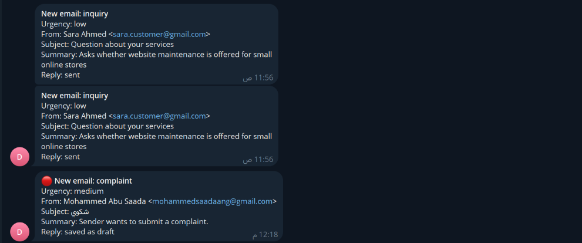

# مساعد الرد الذكي على Gmail

Workflow لـ n8n يتابع الرسائل الجديدة في صندوق Gmail، ينظفها ويصنّفها بالذكاء الاصطناعي، ثم يكتب ردًا بلغة المرسل. افتراضيًا، يحفظ الرد كمسودة لمراجعتها؛ ويمكن ضبط أنواع محددة للإرسال التلقائي.

## ماذا يفعل؟

1. يلتقط الرسائل الجديدة غير المقروءة في Inbox.
2. يزيل HTML والاقتباسات القديمة، ويتعامل مع الرسائل العربية والإنجليزية.
3. يتجاوز الرسائل غير المناسبة مثل الرسائل الإعلانية أو الرسائل التي عولجت مسبقًا.
4. يصنف الرسالة حسب نوعها وأهميتها، مثل استفسار أو شكوى أو طلب عرض سعر أو اجتماع أو spam.
5. ينشئ ردًا بلغة المرسل، ثم يحفظه كمسودة أو يرسله وفق إعداد `autoSendTypes`.
6. يضيف Label للرسائل التي عالجها، ويمكنه إرسال إشعار إلى Telegram.

## المتطلبات

- n8n.
- Gmail OAuth2 بصلاحيات قراءة الرسائل وإضافة التصنيفات وإنشاء المسودات، وصلاحية الإرسال إذا فعّلت الإرسال التلقائي.
- OpenAI API.
- Telegram Bot API للإشعارات (اختياري بحسب استخدام المسار).

## الإعداد

1. استورد [`workflow.json`](./workflow.json) إلى n8n.
2. اربط بيانات اعتماد Gmail وOpenAI وTelegram بالعقد المناسبة.
3. افتح عقدة **Config** وخصص `myName` و`myEmail` و`businessName` و`signature`.
4. راجع `autoSendTypes`. القيمة الافتراضية `[]` تحفظ الردود كمسودات؛ لا تضف أنواعًا للإرسال إلا بعد اختبار الردود ومراجعة شروطك.
5. ضع `telegramChatId` إذا أردت استقبال الإشعارات.
6. راجع Labels مثل `auto-replied` و`spam-filtered`، وتأكد أن حساب Gmail يستطيع إنشاءها أو استخدامها.

## التشغيل والاختبار

- استخدم **Manual Test** لاختبار أحدث رسالة غير مقروءة، أو اترك Gmail Trigger يلتقط الرسائل الجديدة.
- ابدأ بإعداد `autoSendTypes` الافتراضي، ثم راجع المسودة في Gmail قبل إرسالها يدويًا.
- اختبر حالات عربية وإنجليزية، ورسائل لا ينبغي الرد عليها، ورسائل سبق التعامل معها.
- بعد التأكد، فعّل trigger. راجع سجل التنفيذ وLabels عند ظهور نتائج غير متوقعة.

> **تنبيه:** هذا workflow يتعامل مع البريد ويرسل ردودًا نيابةً عنك. اترك الإرسال التلقائي معطّلًا أثناء التجربة، ولا تفعّله إلا لأنواع راجعتها بعناية.

## الصور

مخطط التصنيف وإنشاء الرد في n8n:

مثال إشعارات Telegram لبعض الرسائل التي عالجها workflow:

## الملفات

- [`workflow.json`](./workflow.json): ملف الاستيراد إلى n8n.
- [`caption-ar.txt`](./caption-ar.txt): نص المنشور العربي للمشروع.
- [`screenshots/`](./screenshots/): صور workflow وإشعاراته.

> الصور المرفقة كما هي. راجعها والتصدير قبل النشر العام، واستبدل أي أسماء أو عناوين أو معرّفات تخصك.
