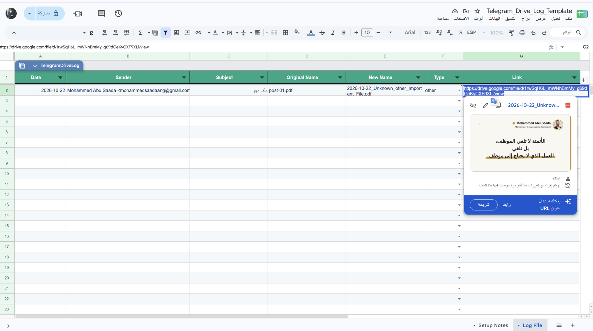

# حفظ مرفقات Gmail في Google Drive

Workflow لـ n8n يفحص رسائل Gmail التي تحتوي على مرفقات، يفلتر الملفات بحسب النوع والحجم، ويقرأ محتواها لتصنيفها واقتراح اسم واضح. ثم ينشئ مجلدات منظمة في Google Drive ويرفع الملفات ويسجل نتائجها في Google Sheets.

## ماذا يفعل؟

1. يراقب Gmail بحثًا عن رسائل تحتوي على مرفقات لم تحمل Label `saved-to-drive`.
2. يقسم المرفقات ويتجاهل الملفات التي لا تطابق إعدادات الأنواع والحجم.
3. يستخرج نص PDF أو يقرأ الصور باستخدام OpenAI Vision.
4. يصنف الملف ويكوّن اسمًا يتضمن التاريخ والجهة ونوع المستند وعنوانه.
5. ينشئ أو يعثر على مجلد الشهر ومجلد نوع المستند في Drive.
6. يرفع الملف، ويتجنب تكرار الاسم بإضافة لاحقة عند الحاجة.
7. يكتب تفاصيل العملية في Google Sheets، ويضيف Label إلى الرسالة ويرسل ملخصًا إلى Telegram.

## المتطلبات

- n8n.
- Gmail OAuth2 مع صلاحية قراءة الرسائل وإضافة Labels وتنزيل المرفقات.
- Google Drive OAuth2 لصلاحية إنشاء المجلدات ورفع الملفات.
- Google Sheets OAuth2 لصلاحية إضافة صفوف إلى سجل العمليات.
- OpenAI API لاستخراج وتصنيف محتوى الملفات.
- Telegram Bot API للإشعارات.

## الإعداد

1. استورد [`workflow.json`](./workflow.json) إلى n8n واربط بيانات اعتماد الخدمات المذكورة.
2. افتح **Config** وراجع `telegramChatId` و`allowedTypes` و`maxSizeMB`. الإعداد الافتراضي يقبل PDF وDOCX وXLSX وPNG وJPG حتى 20 MB.
3. في **Search Month Folder** و**Create Month Folder** اختر مجلد Drive الجذر الذي ستُحفظ تحته الملفات.
4. في **Log File** اختر Google Spreadsheet واسم الورقة المناسبين.
5. جهّز صف العناوين في ورقة السجل بهذه الحقول: `Date`, `Sender`, `Subject`, `Original Name`, `New Name`, `Type`, `Link`.
6. تحقق من إعدادات Gmail query وLabel `saved-to-drive` لمنع معالجة الرسالة نفسها مرة أخرى.

## التشغيل والاختبار

- شغّل **Manual Trigger (Test)**؛ مسار الاختبار يجلب حتى 3 رسائل مطابقة للاستعلام.
- اختبر أولًا بمرفقات غير حساسة، وتحقق من أسماء الملفات ومجلداتها وسجل Google Sheets.
- بعد التأكد من صلاحيات Drive وSheets ووصول إشعار Telegram، فعّل Gmail Trigger.
- عند فشل الرفع أو التسجيل، افحص تنفيذ العقدة وسجل Google Sheets وصلاحيات المجلد والورقة.

## الصور

مخطط workflow الذي يعالج المرفقات ويحفظها:

مثال لسجل الملفات المرفوعة في Google Sheets:

## الملفات

- [`workflow.json`](./workflow.json): ملف الاستيراد إلى n8n.
- [`caption-ar.txt`](./caption-ar.txt): نص المنشور العربي للمشروع.
- [`screenshots/`](./screenshots/): صور workflow وسجل الملفات.

> قبل النشر العام، راجع الصورة والتصدير؛ قد يظهر فيهما اسم حساب أو بريد أو رابط Drive أو معرّف مورد. استبدل الإعدادات المربوطة بحسابك بقيم بيئتك.
