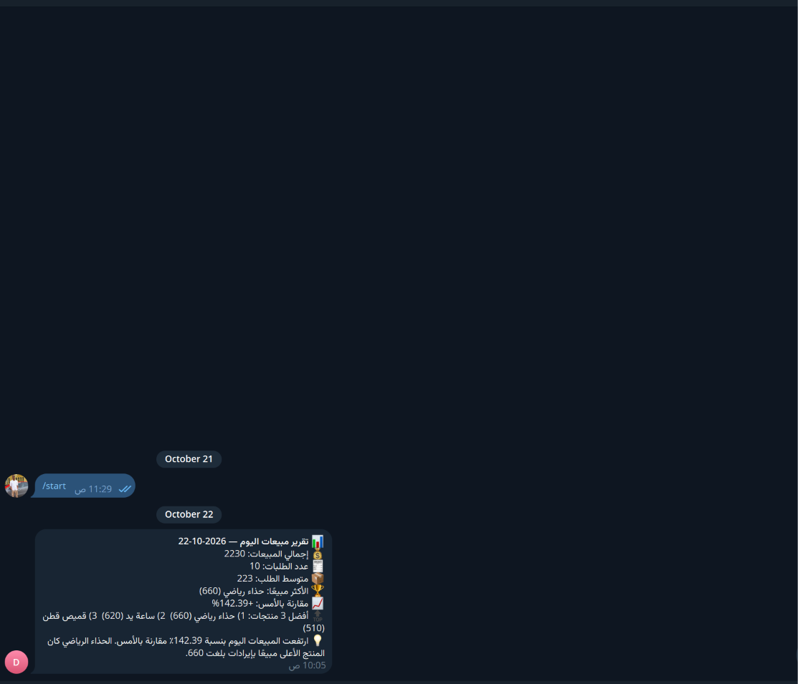

# تقرير المبيعات اليومي إلى Telegram

Workflow لـ n8n يقرأ بيانات المبيعات من Google Sheets، يحسب مؤشرات اليوم ويقارنها باليوم السابق، ثم يضيف ملخصًا تحليليًا عربيًا ويرسله إلى Telegram. يعمل تلقائيًا كل يوم الساعة 21:00 بتوقيت `Asia/Hebron` أو يمكن تشغيله يدويًا.

## ماذا يفعل؟

1. يقرأ صفوف المبيعات من ملف Google Sheets المحدد.
2. يحسب إجمالي المبيعات وعدد الطلبات ومتوسط الطلب والمنتج الأعلى مبيعًا وأفضل ثلاثة منتجات.
3. يقارن النتائج باليوم السابق.
4. يكتب ملاحظة موجزة بمساعدة OpenAI ويرسل التقرير إلى Telegram.
5. يرسل إشعارًا بديلًا إذا لم يجد مبيعات لليوم.

## المتطلبات

- n8n.
- Google Sheets OAuth2 مع صلاحية قراءة ملف المبيعات.
- OpenAI API.
- Telegram Bot API ومعرّف المحادثة المستقبلة.
- ورقة بيانات تحتوي على أعمدة: `Date`, `Order ID`, `Product`, `Quantity`, `Price`, `Customer`.

يدعم التاريخ الصيغتين `YYYY-MM-DD` و`DD/MM/YYYY`. ولإظهار المقارنة، جهّز بيانات اختبار لليوم الحالي واليوم السابق.

## الإعداد

1. استورد [`workflow.json`](./workflow.json) إلى n8n.
2. اربط بيانات اعتماد Google Sheets وOpenAI وTelegram.
3. في **Config**، اضبط `telegramChatId` على المحادثة المطلوبة.
4. في **Get Sales Rows**، اختر ملف Google Sheets وورقة المبيعات الصحيحة.
5. تأكد أن أسماء الأعمدة وتنسيق التواريخ مطابقان لما يتوقعه workflow.
6. تحقق من موعد **Every Day 21:00** والمنطقة الزمنية، وعدّلهما عند الحاجة.

## التشغيل والاختبار

- شغّل **Manual Test** أولًا.
- تأكد من وجود صفوف بتاريخ اليوم واليوم السابق، ثم تحقق من الأرقام والمنتج الأعلى مبيعًا ووصول التقرير إلى Telegram.
- إذا لم توجد مبيعات اليوم، سيرسل workflow إشعارًا بدل التقرير.
- بعد نجاح الاختبار، فعّل workflow المجدول. راجع سجلات التنفيذ وأذونات الملف عند حدوث خطأ.

## الصور

مخطط قراءة البيانات وتجهيز التقرير في n8n:

مثال للتقرير النهائي في Telegram:

## الملفات

- [`workflow.json`](./workflow.json): ملف الاستيراد إلى n8n.
- [`caption-ar.txt`](./caption-ar.txt): نص المنشور العربي للمشروع.
- [`screenshots/`](./screenshots/): صور workflow ونتيجة التقرير.

> قبل النشر العام، راجع الصور وملف التصدير واستبدل أي أسماء أو معرّفات تخص حساباتك أو ملفاتك.
