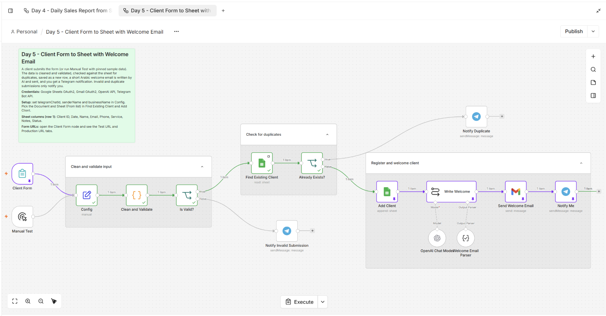
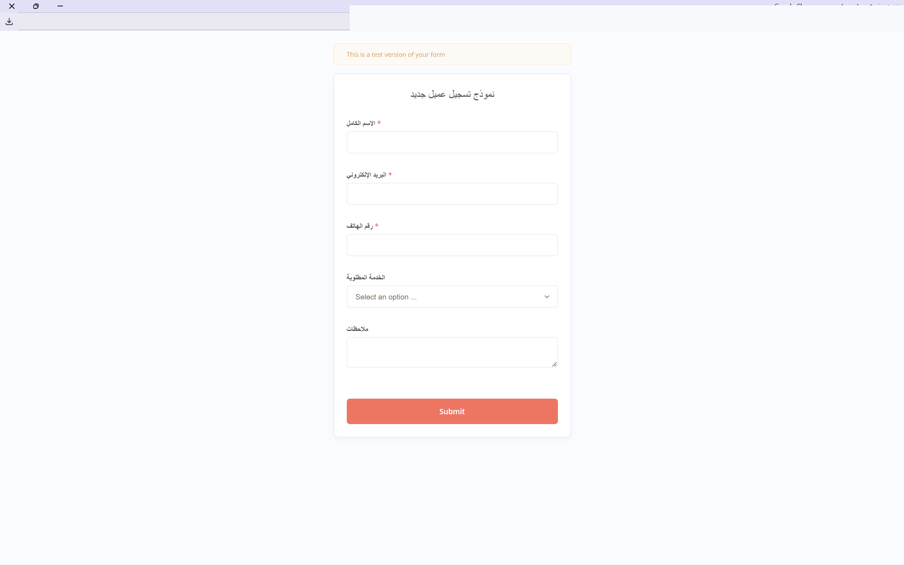
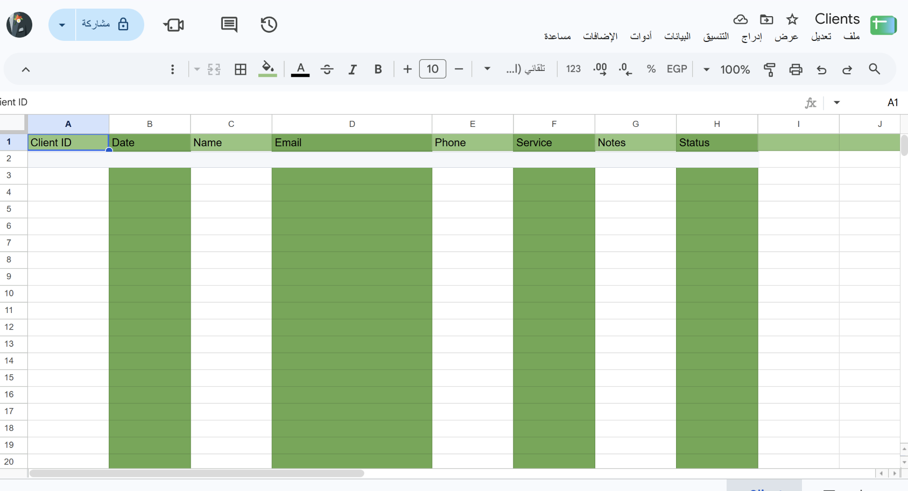

# استقبال العملاء وإرسال رسالة ترحيب

Workflow لـ n8n يستقبل بيانات العميل من نموذج عربي، يتحقق منها، ويتأكد من عدم تكرار البريد الإلكتروني قبل تسجيل العميل في Google Sheets. بعد التسجيل، ينشئ رسالة ترحيب عربية قصيرة باستخدام OpenAI ويرسلها عبر Gmail، ثم يرسل إشعارًا إلى Telegram.

## ماذا يفعل؟

1. يستقبل الاسم والبريد الإلكتروني ورقم الهاتف والخدمة المطلوبة والملاحظات من نموذج n8n.
2. ينظف المدخلات ويتحقق من الاسم والبريد ورقم الهاتف.
3. يبحث في جدول العملاء عن بريد إلكتروني مسجل مسبقًا؛ الطلب المكرر لا يضيف سجلًا جديدًا.
4. يضيف العميل الجديد إلى Google Sheets.
5. يكتب رسالة ترحيب عربية قصيرة، ثم يرسلها إلى العميل عبر Gmail.
6. يرسل إشعار Telegram عند تسجيل عميل أو اكتشاف طلب مكرر أو بيانات غير صالحة.

## المتطلبات

- n8n مع إمكانية نشر النموذج.
- Google Sheets OAuth2 لإنشاء السجل والتحقق من العملاء السابقين.
- Gmail OAuth2 لإرسال رسائل الترحيب.
- OpenAI API لكتابة رسالة الترحيب.
- Telegram Bot API لإشعارات الإدارة.

## إعداد سير العمل

1. استورد [`workflow.json`](./workflow.json) إلى n8n.
2. اربط بيانات اعتماد Google Sheets وGmail وOpenAI وTelegram.
3. في عقدة **Config**، عيّن `telegramChatId` و`senderName` و`businessName`.
4. في عقدتي **Find Existing Client** و**Add Client**، اختر ملف العملاء والورقة الصحيحين.
5. تأكد من وجود الأعمدة في الصف الأول بهذا الترتيب: `Client ID`, `Date`, `Name`, `Email`, `Phone`, `Service`, `Notes`, `Status`.
6. افتح عقدة **Client Form** وانسخ **Test URL** للاختبار. استخدم **Production URL** بعد تفعيل workflow.

## التشغيل والاختبار

- استخدم **Manual Test** مع بيانات اختبار مثبتة، أو أرسل إدخالًا عبر رابط الاختبار.
- جرّب طلبًا صالحًا، وبريدًا مكررًا، وبريدًا أو هاتفًا غير صالح.
- تحقق من صف Google Sheets، ورسالة الترحيب، وإشعار Telegram.
- بعد الاختبار، فعّل workflow وانشر رابط الإنتاج فقط. لا تستخدم بيانات عملاء حقيقية في الاختبارات العامة.

## الصور

مخطط التحقق من الطلب وتسجيل العميل وإرسال الترحيب:

نموذج تسجيل العميل:

لقطة من جدول العملاء بعد إخفاء بيانات المثال:

إشعار تسجيل العميل في Telegram:

## الملفات

- [`workflow.json`](./workflow.json): ملف الاستيراد إلى n8n.
- [`caption-ar.txt`](./caption-ar.txt): نص عربي مقترح للتعريف بالمشروع.
- [`templates/client-register-template.xlsx`](./templates/client-register-template.xlsx): قالب سجل فارغ بعناوين الأعمدة المطلوبة.
- [`screenshots/`](./screenshots/): صور الـworkflow والنموذج والنتائج.

> **الخصوصية:** هذا الـworkflow يتعامل مع بيانات شخصية، ويرسل بيانات العميل إلى Google Sheets وGmail وOpenAI، كما تتضمن إشعارات Telegram بعض تفاصيل الطلب. عقدة إشعار الطلب غير الصالح ترسل البيانات الخام؛ وجّه الإشعارات إلى محادثة خاصة. أُخفيت بيانات سجل الاختبار ورابط النموذج من الصور، وحُفظت النسخ الأصلية محليًا داخل `private-assets/` المستثنى من Git.
