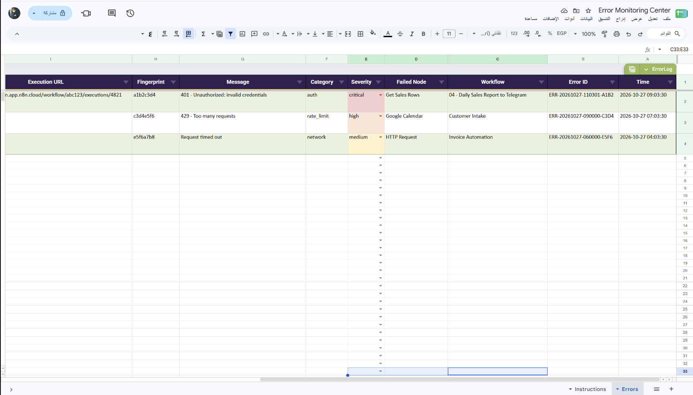

# مركز مراقبة أخطاء n8n

Workflow مركزي يستقبل أخطاء workflows أخرى، يصنفها بقواعد واضحة، يسجلها في Google Sheets، ويرسل تنبيهًا إلى Telegram. يمكنه إرسال بريد للأخطاء الحرجة وإرسال ملخص يومي بالأخطاء المسجلة.

## ماذا يفعل؟

1. يستقبل بيانات الخطأ من أي workflow تم تعيينه لاستخدام هذا الـ workflow كـ **Error workflow**.
2. يصنف الخطأ إلى صلاحيات أو حد طلبات أو خادم أو شبكة أو بيانات، ويحدد مستوى الخطورة واقتراحًا أوليًا للحل.
3. ينشئ بصمة للخطأ؛ الأخطاء المتكررة خلال نافذة التجميع تسجل دون تنبيه Telegram جديد، مع إعادة تنبيه دوري للأخطاء الحرجة.
4. يسجل تفاصيل التنفيذ في ورقة `Errors`، ويرسل تنبيه Telegram عند استحقاقه.
5. يرسل بريدًا للأخطاء الحرجة، ويقرأ سجل آخر 24 ساعة لإرسال ملخص Telegram يوميًا عند 20:00.

## المتطلبات

- n8n مع إمكانية تعيين Error workflow للـ workflows المراد مراقبتها.
- Google Sheets OAuth2 وملف سجل الأخطاء المرفق.
- Telegram Bot API ومحادثة خاصة للتنبيهات والملخص.
- Gmail OAuth2 لإشعارات الأخطاء الحرجة.

## الإعداد

1. استورد [`workflow.json`](./workflow.json) إلى n8n.
2. اربط بيانات اعتماد Google Sheets وTelegram وGmail.
3. افتح عقد Google Sheets الثلاث: **Find Same Fingerprint** و**Log to Error Sheet** و**Read Error Log**، واختر ملف السجل وورقة `Errors`.
4. في **Config**، عيّن `telegramChatId` و`alertEmail` ومدة `dedupeWindowMinutes` وأسماء workflows الحرجة في `criticalWorkflows`.
5. افتح **Digest Config** وحدد وجهة Telegram وملف السجل، وتحقق من منطقة n8n الزمنية وموعد التشغيل اليومي 20:00.
6. في كل workflow تريد مراقبته، افتح **Settings > Error workflow** واختر **06 - Error Monitoring Center**.

## التشغيل والاختبار

- استخدم **Manual Test** لتجربة الخطأ النموذجي والتحقق من التصنيف والسجل والتنبيه.
- اختبر خطأً متكررًا داخل نافذة التجميع، ثم خطأً حرجًا، وتأكد من سلوك التنبيه والبريد.
- تحقق من وصول الملخص بعد ضبط منطقة n8n الزمنية. لا تفعّل المراقبة قبل اختبار مسارات Telegram وGmail.

## الصور والملفات

- [`workflow.json`](./workflow.json): ملف الاستيراد إلى n8n.
- [`caption-ar.txt`](./caption-ar.txt): نص المنشور العربي للمشروع.
- [`templates/template.xlsx`](./templates/template.xlsx): ملف سجل الأخطاء وتعليماته.
- [`screenshots/`](./screenshots/): صور الـ workflow وسجل الأخطاء.

> التصنيف مبني على مطابقة أنماط رسائل الخطأ، وليس تشخيصًا مضمونًا. راجع التنفيذ والعقدة الفاشلة قبل تطبيق اقتراح الحل. قد تتضمن سجلات الأخطاء رسائل أو روابط تنفيذ حساسة؛ قيد الوصول إلى الجدول ومحادثات التنبيه.