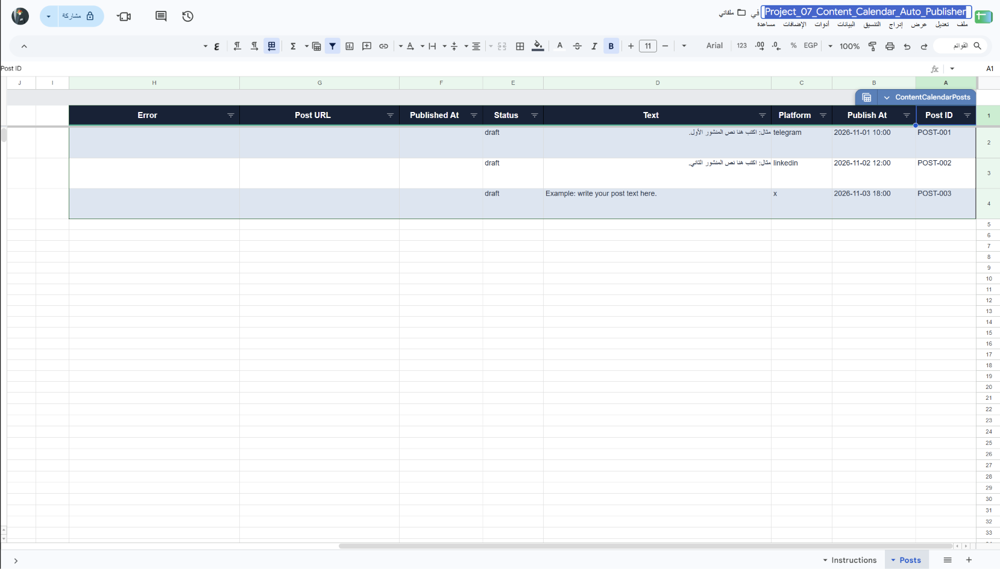
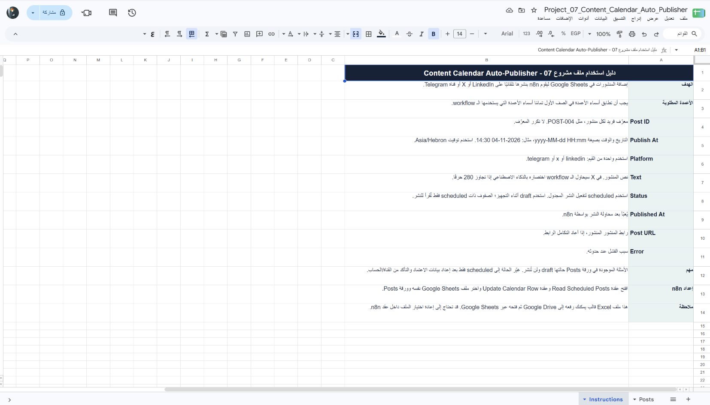

# ناشر تقويم المحتوى

Workflow لـ n8n يقرأ المنشورات المجدولة من Google Sheets كل 15 دقيقة، وينشر كل منشور على LinkedIn أو X أو قناة Telegram، ثم يحدث صفه بنتيجة النشر ورابطه أو سبب الفشل.

## ماذا يفعل؟

1. يقرأ الصفوف التي حالتها `scheduled`، ويتحقق من موعد النشر، ثم يعالج حتى العدد المحدد في الإعدادات.
2. يوجه المنشور إلى المنصة المحددة في عمود `Platform`.
3. يمرر منشورات X التي تتجاوز 280 حرفًا إلى OpenAI لاختصارها باللغة نفسها قبل النشر.
4. يحدث الحالة إلى `published` أو `failed`، ويسجل الرابط أو سبب الخطأ دون إيقاف المنشورات الأخرى.
5. يرسل تقريرًا موجزًا إلى Telegram بعد التشغيل.

## المتطلبات

- n8n وGoogle Sheets OAuth2.
- بيانات اعتماد LinkedIn وX وTelegram للوجهات المستخدمة.
- OpenAI API لاختصار المنشورات الطويلة على X.
- نسخة من ملف تقويم المحتوى المرفق.

## إعداد جدول المحتوى

1. ارفع [`template.xlsx`](./templates/template.xlsx) إلى Google Drive وافتحه كـ Google Sheets، أو أنشئ جدولًا بورقة `Posts`.
2. احتفظ بأسماء الأعمدة: `Post ID`, `Publish At`, `Platform`, `Text`, `Status`, `Published At`, `Post URL`, `Error`.
3. اترك الأمثلة بحالة `draft`. غيّر الحالة إلى `scheduled` فقط عندما يصبح المنشور جاهزًا للنشر.
4. أدخل الموعد بصيغة `yyyy-MM-dd HH:mm` واضبط المنطقة الزمنية في إعدادات workflow على المنطقة التي تريد اعتمادها.

## إعداد وتشغيل workflow

1. استورد [`workflow.json`](./workflow.json) إلى n8n واربط بيانات اعتماد Google Sheets وLinkedIn وX وTelegram وOpenAI.
2. اختر ملف التقويم وورقة `Posts` في عقدتي **Read Scheduled Posts** و**Update Calendar Row**.
3. في **Config**، عيّن `telegramChannelId` و`adminChatId` و`maxPostsPerRun`.
4. اختر ملف LinkedIn والوجهة في عقدة النشر، وتحقق من صلاحيات التطبيقات والحسابات لكل منصة.
5. نفّذ اختبارًا بمنشور واحد ووجهة تملكها، ثم تحقق من تحديث الصف ورابط المنشور وإشعار Telegram.

## الصور والملفات

تعليمات ملف الجدول: 

- [`workflow.json`](./workflow.json): ملف الاستيراد إلى n8n.
- [`caption-ar.txt`](./caption-ar.txt): نص المنشور العربي للمشروع.
- [`templates/template.xlsx`](./templates/template.xlsx): تقويم محتوى تجريبي مع ورقة تعليمات.
- [`screenshots/`](./screenshots/): صور الـ workflow والجدول والتعليمات.

> تنبيه: الاختبار اليدوي قد ينشر فعلًا على LinkedIn أو X أو Telegram. استخدم حسابات وقنوات اختبار، وابدأ بمنشور واحد. لا تضع محتوى حقيقيًا في حالة `scheduled` قبل مراجعة الجدول والتوقيت والمنطقة الزمنية.