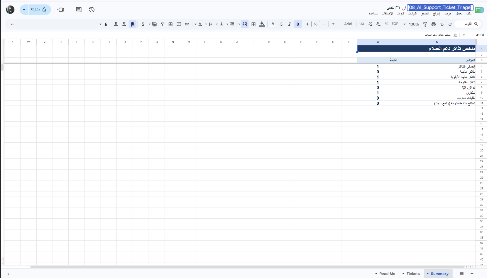
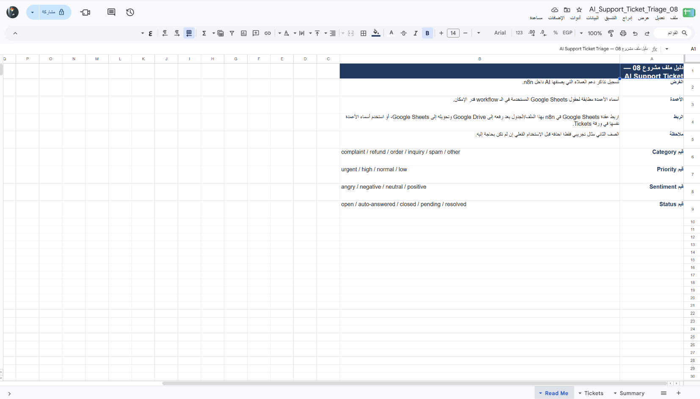

# فرز تذاكر دعم العملاء

Workflow لـ n8n يجمع الرسائل الواردة من نموذج الموقع وبوت Telegram، ويحول كل رسالة إلى تذكرة ذات رقم فريد. يستخدم OpenAI لاقتراح التصنيف والأولوية والملخص والرد، ثم يطبق قواعد تصعيد ومواعيد استجابة قبل تسجيل التذكرة وتوجيهها.

## ماذا يفعل؟

1. يستقبل رسالة الموقع عبر Webhook ورسائل العملاء عبر Telegram، ثم يوحد صيغة البيانات.
2. يصنف الرسالة إلى شكوى أو استرداد أو طلب أو استفسار أو سبام، ويولد ملخصًا عربيًا وردًا بلغة العميل.
3. يطبق قواعد للأولوية وموعد الاستجابة (SLA)، ويحول الحالات منخفضة الثقة للمراجعة البشرية.
4. يسجل التذاكر في Google Sheets، ويوجهها إلى محادثة الدعم أو المبيعات، ويتجاهل السبام.
5. يرسل تأكيد استلام للعميل في القناة المناسبة، ويمكنه الرد تلقائيًا على الاستفسارات الواضحة عند تفعيل الخيار.

## المتطلبات

- n8n مع عنوان Webhook متاح لنموذج الموقع.
- Telegram Bot API لبوت استقبال العملاء وقنوات إشعار الفريق.
- OpenAI API للتصنيف وتوليد الملخص والرد المقترح.
- Google Sheets OAuth2 وGmail OAuth2 لتسجيل التذاكر ورسائل تأكيد الموقع.
- نسخة من قالب سجل التذاكر المرفق.

## الإعداد

1. ارفع [`template.xlsx`](./templates/template.xlsx) إلى Google Drive وافتحه كـ Google Sheets. احتفظ بورقتي `Tickets` و`Summary`.
2. استورد [`workflow.json`](./workflow.json) إلى n8n واربط بيانات اعتماد Telegram وOpenAI وGoogle Sheets وGmail.
3. اختر ملف Sheets في عقدة **Log Ticket**، وتحقق من تطابق أعمدة ورقة `Tickets` مع القالب.
4. في **Config**، عيّن `supportChatId` و`salesChatId` و`businessName`. اترك `autoAnswerInquiries` معطلًا أثناء الاختبار.
5. اربط Telegram Trigger ببوت مخصص، واختبر استقبال الرسائل والتوجيه والتأكيد.
6. لنموذج الموقع، أرسل `POST` بصيغة JSON تحتوي على `name` و`email` و`message` إلى عنوان Webhook الذي يوفره n8n.
7. استخدم **Test URL** أثناء التطوير، ولا تنشر **Production URL** قبل إضافة الحماية المناسبة والتحقق من المدخلات.

## التشغيل والاختبار

- ابدأ بـ **Manual Test** ورسالة تجريبية، ثم افحص التصنيف والأولوية وموعد الاستجابة والصف المسجل.
- اختبر رسالة من كل قناة، وحالة سبام، وحالة تحتاج مراجعة بشرية، قبل تفعيل الرد التلقائي.
- راجع وجهات إشعارات Telegram والبريد، وتأكد من أن الفريق المخول وحده يستطيع الوصول إلى بيانات التذاكر.

## الصور والملفات

تعليمات القالب: 

- [`workflow.json`](./workflow.json): ملف الاستيراد إلى n8n.
- [`caption-ar.txt`](./caption-ar.txt): نص المنشور العربي للمشروع.
- [`templates/template.xlsx`](./templates/template.xlsx): قالب سجل التذاكر وملخصها.
- [`screenshots/`](./screenshots/): صور الـ workflow والجدول.

> رسائل العملاء بيانات شخصية وقد تُرسل إلى OpenAI وGoogle Sheets وTelegram وGmail. استخدم بيانات اختبار، وقيّد مشاركة الجدول ومحادثات الفريق، وعطّل الرد التلقائي أولًا. لا تعرض Webhook عامًّا دون ضوابط وصول ومكافحة إساءة الاستخدام.