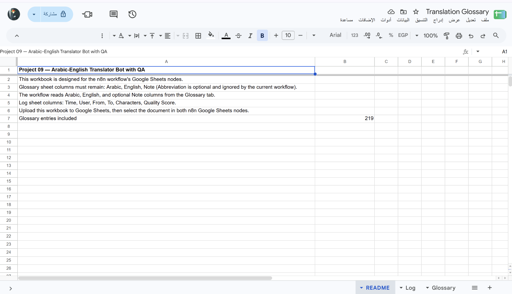
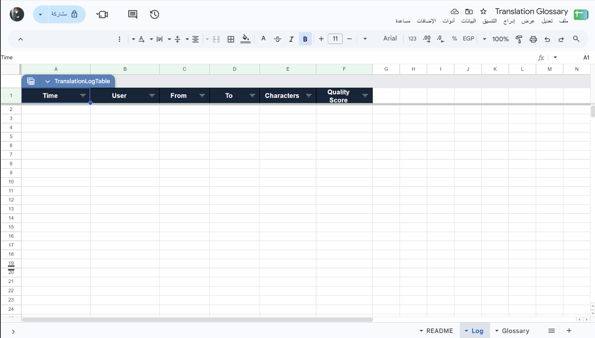

# بوت ترجمة عربي وإنجليزي مع مراجعة الجودة

Workflow لـ n8n يستقبل النصوص عبر Telegram، يحدد اتجاه الترجمة تلقائيًا أو من أمر، ويطبق قاموس مصطلحات من Google Sheets. بعد الترجمة، يراجعها نموذج ثانٍ ويقيّمها من 1 إلى 10؛ إذا كان التقييم أقل من 8 يحاول تحسينها قبل إرسال النتيجة.

## ماذا يفعل؟

1. يستقبل رسالة Telegram ويستخرج النص وأمر اللغة أو النبرة إن وجد.
2. يحدد العربية إلى الإنجليزية، وأي لغة أخرى إلى العربية، أو يستخدم `/en` و`/ar` لتحديد الوجهة، و`/casual` لأسلوب ودّي.
3. يطابق المصطلحات مع ورقة `Glossary` ويضمّن المقابلات المطلوبة في طلب الترجمة.
4. يترجم النص، ثم يراجعه من حيث الدقة والحذف والالتزام بالقاموس والطلاقة. يحسّن النتيجة عندما تكون الدرجة أقل من 8.
5. يرسل الترجمة والتقييم والملاحظات إلى Telegram، ويسجل بيانات الاستخدام في ورقة `Log` دون تخزين نص المصدر أو الترجمة.

## المتطلبات

- n8n وTelegram Bot API.
- Google Sheets OAuth2 وملف القاموس المرفق.
- OpenAI API للترجمة ومراجعة الجودة.

## الإعداد

1. ارفع [`template.xlsx`](./templates/template.xlsx) إلى Google Drive وافتحه كـ Google Sheets، مع الإبقاء على ورقتي `Glossary` و`Log`.
2. تحقق من أعمدة `Glossary`: `Arabic`, `English`, `Note`. عمود `Abbreviation` في القالب مرجعي ولا يقرأه الـ workflow.
3. تحقق من أعمدة `Log`: `Time`, `User`, `From`, `To`, `Characters`, `Quality Score`.
4. استورد [`workflow.json`](./workflow.json) إلى n8n، واربط بيانات اعتماد Telegram وGoogle Sheets وOpenAI.
5. اختر ملف Google Sheets نفسه في عقدتي **Load Glossary** و**Log Translation**، ثم فعّل Telegram Trigger.
6. أرسل `/start` إلى البوت لعرض الأوامر، ثم اختبره بنص غير حساس من محادثتك الخاصة.

## الصور والملفات

- [`workflow.json`](./workflow.json): ملف الاستيراد إلى n8n.
- [`caption-ar.txt`](./caption-ar.txt): نص المنشور العربي للمشروع.
- [`templates/template.xlsx`](./templates/template.xlsx): قاموس مصطلحات وسجل استخدام مع أوراق التعليمات.
- [`screenshots/`](./screenshots/): صور الـ workflow والقاموس والسجل.

> نصوص الترجمة تُرسل إلى OpenAI للمعالجة، حتى وإن لم تُحفظ في سجل Google Sheets. تجنب إرسال المعلومات السرية، وراجع الترجمات المهمة يدويًا؛ تقييم النموذج لا يضمن خلو الترجمة من الأخطاء.