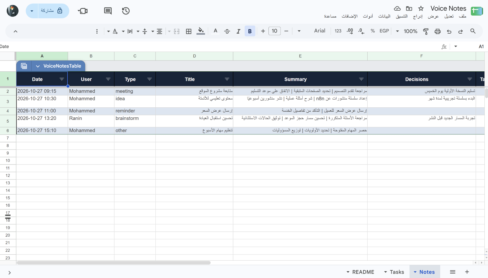
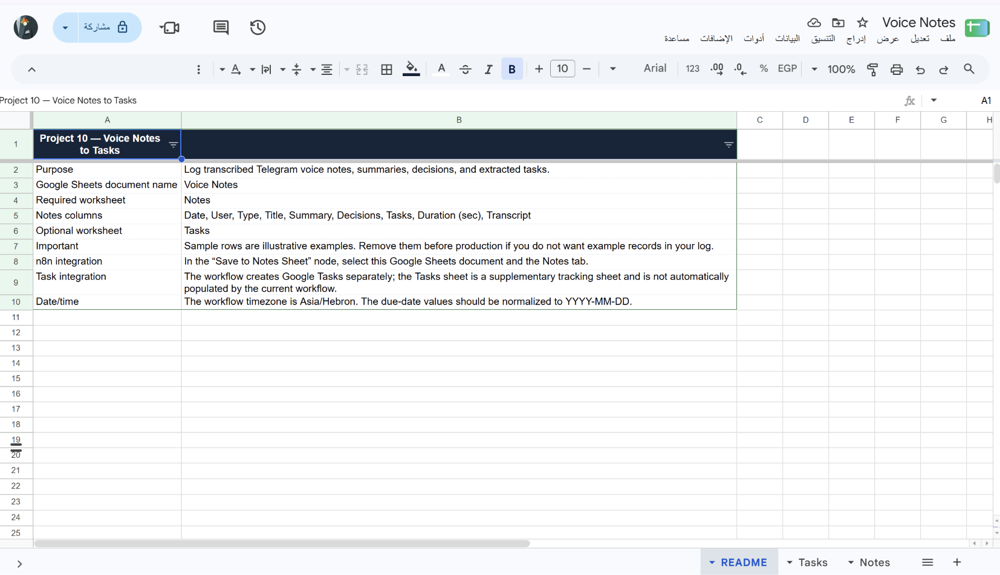

# الملاحظات الصوتية إلى مهام

Workflow لـ n8n يستقبل رسالة صوتية من Telegram، يفرغها إلى نص، ويستخرج عنوانًا وخلاصة وقرارات ومهامًا. يرسل النتيجة إلى Telegram، ويحفظ الملاحظة في Google Sheets، وينشئ كل مهمة في Google Tasks.

## ماذا يفعل؟

1. يقبل الرسائل الصوتية أو الملفات الصوتية حتى 15 دقيقة؛ ويطلب تقسيم الرسائل الأطول.
2. يفرغ الصوت عبر OpenAI، ثم يصنف الملاحظة ويستخرج ملخصًا وقرارات ومهامًا قابلة للتنفيذ.
3. يحول المواعيد النسبية المذكورة إلى تاريخ، ولا يفترض مهامًا أو أشخاصًا أو تواريخ غير موجودة في التسجيل.
4. يرسل الملخص والمهام والنص المفرغ في رد Telegram.
5. يحفظ التفاصيل والتفريغ الكامل في ورقة `Notes`، وينشئ كل مهمة في قائمة Google Tasks الافتراضية.

## المتطلبات

- n8n وTelegram Bot API.
- OpenAI API للتفريغ الصوتي واستخراج المعلومات.
- Google Sheets OAuth2 وملف سجل الملاحظات المرفق.
- Google Tasks OAuth2 لإنشاء المهام.

## الإعداد

1. ارفع [`template.xlsx`](./templates/template.xlsx) إلى Google Drive وافتحه كـ Google Sheets، ثم اختر الملف في عقدة **Save to Notes Sheet**.
2. تأكد من وجود ورقة `Notes` وأعمدتها كما في القالب. ورقة `Tasks` في القالب مرجعية فقط؛ المهام الفعلية تُنشأ في Google Tasks.
3. استورد [`workflow.json`](./workflow.json) إلى n8n واربط بيانات اعتماد Telegram وOpenAI وGoogle Sheets وGoogle Tasks.
4. في عقدة **Create Google Task**، اختر قائمة المهام المناسبة بدل `@default` عند الحاجة.
5. اربط Telegram Trigger ببوت خاص، وقيّد استقبال الرسائل بمعرّف محادثتك قبل تشغيله في الإنتاج.
6. للاختبار اليدوي، حدّث `chat.id` في عقدة **Sample Message** إلى معرّف محادثة الاختبار حتى يصل الرد إليك.

## التشغيل والاختبار

- جرّب تسجيلًا قصيرًا بالعربية وآخر بالإنجليزية، ثم تحقق من التفريغ والخلاصة والمهام المنشأة.
- اختبر تسجيلًا بلا مهام، ورسالة تتجاوز 15 دقيقة، وتأكد من عدم إنشاء مهام غير مذكورة.
- تحقق من Google Sheets وGoogle Tasks قبل تفعيل workflow.

## الصور والملفات

- [`workflow.json`](./workflow.json): ملف الاستيراد إلى n8n.
- [`caption-ar.txt`](./caption-ar.txt): نص المنشور العربي للمشروع.
- [`templates/template.xlsx`](./templates/template.xlsx): قالب سجل الملاحظات وأمثلة المهام.
- [`screenshots/`](./screenshots/): صور الـ workflow والنتيجة والسجل.

> الصوت يُرسل إلى OpenAI للتفريغ والتحليل، كما يحفظ الـ workflow التفريغ الكامل في Google Sheets ويرسله في Telegram. لا تستخدم محادثة عامة؛ قيد البوت بمعرّف محادثة موثوق، ولا ترسل تسجيلات حساسة.