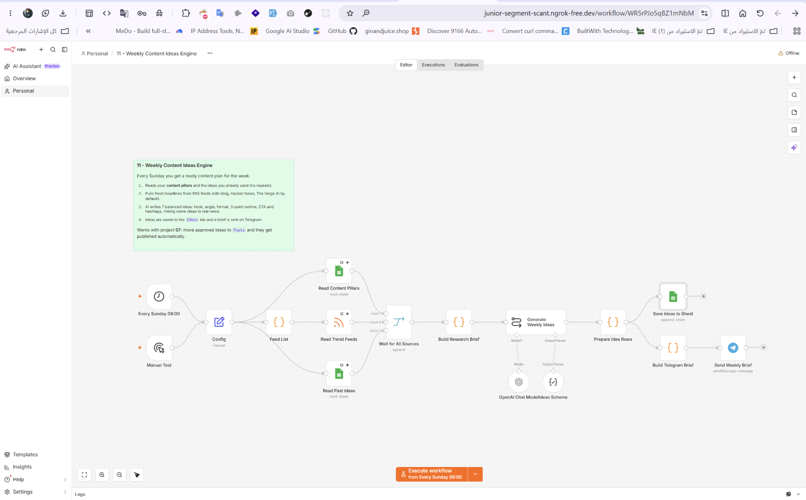

# محرك أفكار المحتوى الأسبوعي

Workflow لـ n8n يعمل كل أحد صباحًا ليولّد خطة محتوى أسبوعية كاملة، يقرأ محاور المحتوى والأفكار القديمة ويجمع آخر أخبار المجال، ثم يكتب سبع أفكار جديدة يحفظها في جدول ويرسل الملخص عبر Telegram.

## ماذا يفعل؟

1. يعمل تلقائيًا كل أحد الساعة 9 صباحًا.
2. يقرأ محاور المحتوى الخاصة بك والأفكار القديمة لتفادي التكرار.
3. يجمع آخر العناوين من مواقع الأخبار التقنية.
4. يستخدم الذكاء الاصطناعي لكتابة 7 أفكار أسبوعية: العنوان، أول سطر جذاب، شكل المنشور، ثلاث نقاط رئيسية، سؤال للتفاعل، وهاشتاغات.
5. يحفظ الأفكار في جدول Google Sheets ويرسل ملخصًا على Telegram.

## المتطلبات

- n8n وTelegram Bot API.
- OpenAI API لتوليد الأفكار.
- Google Sheets OAuth2 لقراءة المحاور والأفكار القديمة وحفظ الجديدة.
- مصادر أخبار تقنية (RSS أو API).

## الإعداد

1. ارفع [`template.xlsx`](./templates/template.xlsx) إلى Google Drive وافتحه كـ Google Sheets.
2. أضف محاور المحتوى الخاصة بك في الورقة المخصصة.
3. استورد [`workflow.json`](./workflow.json) إلى n8n واربط بيانات اعتماد Telegram وOpenAI وGoogle Sheets.
4. تحقق من جدولة التشغيل (كل أحد الساعة 9 صباحًا) وعدّلها حسب توقيتك.
5. اربط Telegram Trigger ببوت خاص وقيّد استقباله بمعرّف محادثتك.

## التشغيل والاختبار

- شغّل الـ workflow يدويًا أول مرة للتحقق من اتصال Sheets وTelegram.
- تأكد من ظهور الأفكار السبع في الجدول وفي رسالة Telegram.
- راجع الأفكار المولّدة وعدّل المحاور إذا احتجت لتحسين الجودة.

## الصور والملفات

- [`workflow.json`](./workflow.json): ملف الاستيراد إلى n8n.
- [`caption-ar.txt`](./caption-ar.txt): نص المنشور العربي للمشروع.
- [`templates/template.xlsx`](./templates/template.xlsx): قالب جدول المحتوى والأفكار.
- [`screenshots/`](./screenshots/): صور الـ workflow والنتيجة.

> الأفكار تُولَّد عبر OpenAI بناءً على محاور المحتوى والأخبار؛ راجع المخرجات قبل النشر وتأكد من ملاءمتها لجمهورك.
