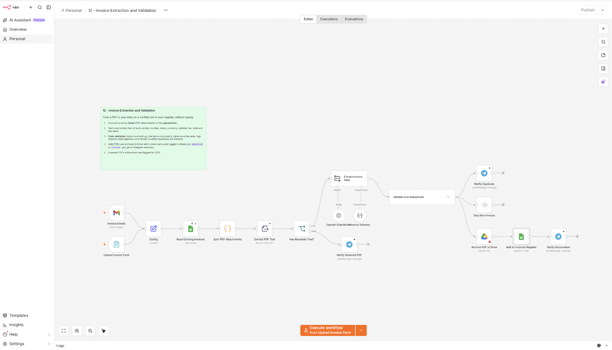

# استخراج الفواتير والتحقق منها

Workflow لـ n8n يستخرج بيانات الفواتير من الصور أو ملفات PDF، يتحقق من اكتمالها وصحتها، ويسجلها في Google Sheets مع إرسال إشعار عبر Telegram.

## ماذا يفعل؟

1. يستقبل الفواتير كصور أو ملفات PDF عبر البريد الإلكتروني أو Telegram.
2. يستخرج البيانات الرئيسية: رقم الفاتورة، التاريخ، المورد، المبلغ، الضريبة، والإجمالي.
3. يتحقق من اكتمال البيانات وصحة الأرقام (التوافق بين الضريبة والإجمالي).
4. يسجل الفاتورة المتحقق منها في جدول Google Sheets.
5. يرسل إشعارًا على Telegram بنتيجة المعالجة أو التنبيه على أي خطأ.

## المتطلبات

- n8n وTelegram Bot API أو Gmail API.
- OpenAI API لاستخراج البيانات من الفواتير.
- Google Sheets OAuth2 لحفظ سجل الفواتير.

## الإعداد

1. ارفع [`template.xlsx`](./templates/template.xlsx) إلى Google Drive وافتحه كـ Google Sheets.
2. تحقق من أعمدة الجدول: `رقم الفاتورة`، `التاريخ`، `المورد`، `المبلغ`، `الضريبة`، `الإجمالي`، `الحالة`.
3. استورد [`workflow.json`](./workflow.json) إلى n8n واربط بيانات اعتماد Telegram وOpenAI وGoogle Sheets.
4. في عقدة الإدخال، اختر المصدر المناسب (Telegram أو Gmail).
5. اضبط قواعد التحقق حسب متطلبات فواتيرك.

## التشغيل والاختبار

- جرّب فاتورة واضحة وأخرى ناقصة البيانات للتحقق من التحقق.
- تأكد من ظهور الفاتورة في Sheets وإرسال إشعار Telegram.
- اختبر صورة فاتورة بجودة منخفضة للتحقق من التعامل مع حالات الخطأ.

## الصور والملفات

- [`workflow.json`](./workflow.json): ملف الاستيراد إلى n8n.
- [`caption-ar.txt`](./caption-ar.txt): نص المنشور العربي للمشروع.
- [`templates/template.xlsx`](./templates/template.xlsx): قالب سجل الفواتير.
- [`screenshots/`](./screenshots/): صور الـ workflow والنتيجة.

> بيانات الفواتير تُرسل إلى OpenAI للاستخراج؛ تجنب إرسال فواتير تحتوي على معلومات سرية للغير. راجع النتائج يدويًا قبل الاعتماد على الأرقام المستخرجة.
