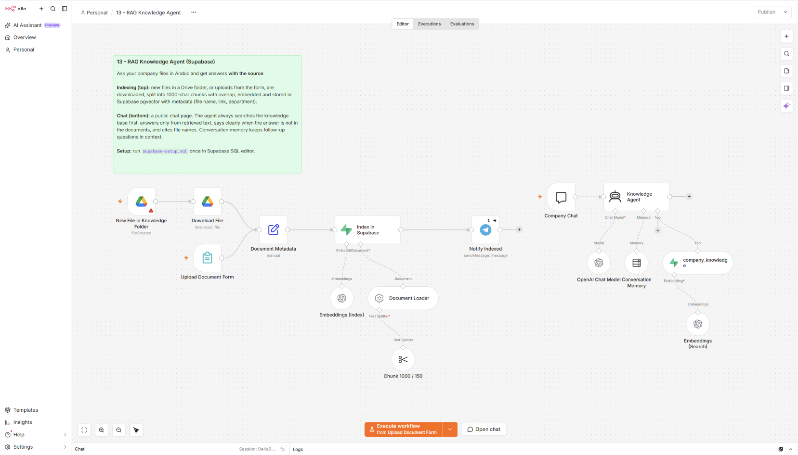

# مساعد المعرفة الداخلي (RAG)

Workflow لـ n8n يبني قاعدة معرفة من مستندات الشركة، ويتيح الاستعلام عنها بالعربية من خلال صفحة محادثة. يجيب المساعد من المستندات فقط مع ذكر المصدر، ويرسل إشعار Telegram عند إضافة مستند جديد.

## ماذا يفعل؟

1. يستقبل المستندات (PDF أو Word) من Google Drive أو نموذج رفع، ويضيفها تلقائيًا لقاعدة المعرفة.
2. يقسّم كل مستند إلى مقاطع، ويحفظها في قاعدة بيانات Supabase مع اسم الملف والقسم.
3. يستقبل أسئلة المستخدم بالعربية ويبحث في المستندات أولًا.
4. يجيب من المستندات فقط دون تخمين، ويذكر اسم الملف المصدر في كل إجابة.
5. إذا لم يجد الجواب، يُخبر المستخدم ويقترح القسم المختص.
6. يتذكر سياق المحادثة لأسئلة المتابعة.
7. يرسل إشعارًا على Telegram كلما أُضيف مستند جديد.

## المتطلبات

- n8n وTelegram Bot API.
- OpenAI API للتضمين (Embeddings) والإجابة.
- Supabase لتخزين المستندات المقسّمة والبحث فيها.
- Google Drive OAuth2 لمراقبة مجلد المستندات.

## الإعداد

1. أنشئ مشروع Supabase وجدولًا لتخزين المقاطع مع حقول: `content`، `metadata`، `embedding`.
2. فعّل pgvector في Supabase لدعم البحث بالتشابه.
3. استورد [`workflow.json`](./workflow.json) إلى n8n واربط بيانات اعتماد OpenAI وSupabase وGoogle Drive وTelegram.
4. حدّد مجلد Google Drive الذي ستراقبه للمستندات الجديدة.
5. اختبر رفع مستند وتأكد من فهرسته في Supabase.

## التشغيل والاختبار

- ارفع مستندًا وانتظر إشعار Telegram لتأكيد الفهرسة.
- اسأل سؤالًا موجود جوابه في المستند وتأكد من دقة الإجابة والمصدر.
- اسأل سؤالًا غير موجود وتأكد من إخبارك بذلك بدلًا من التخمين.
- جرّب سؤال متابعة يعتمد على سياق السؤال السابق.

## الصور والملفات

- [`workflow.json`](./workflow.json): ملف الاستيراد إلى n8n.
- [`caption-ar.txt`](./caption-ar.txt): نص المنشور العربي للمشروع.
- [`screenshots/`](./screenshots/): صور الـ workflow وواجهة المحادثة.

> محتوى مستنداتك يُرسل إلى OpenAI للفهرسة والإجابة. لا ترفع وثائق سرية للغير، وراجع صلاحيات الوصول إلى مجلد Drive قبل تشغيل الـ workflow في الإنتاج.
