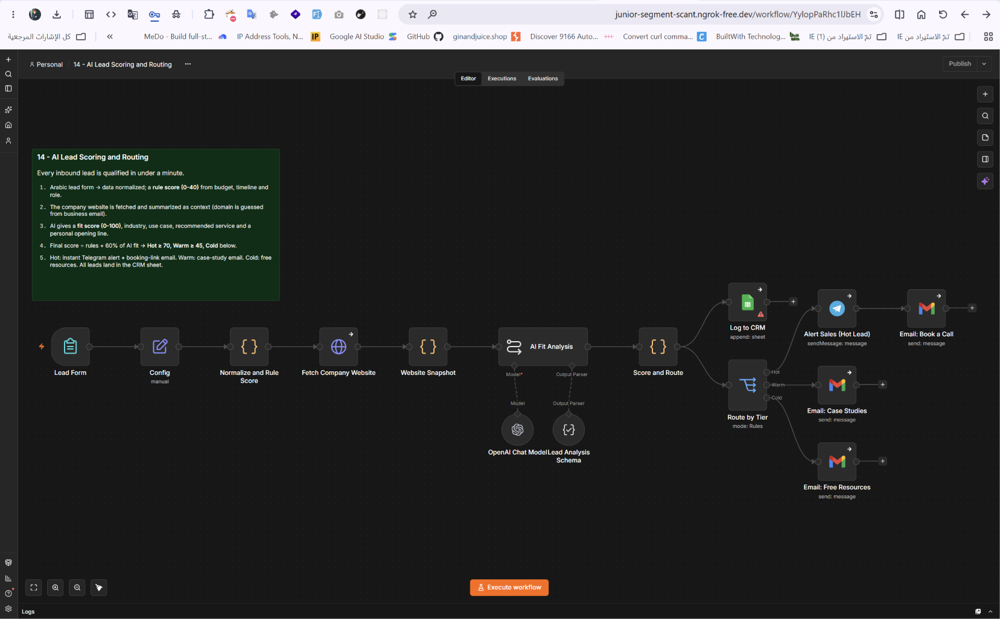

# تقييم العملاء المحتملين وتوزيعهم تلقائيًا

Workflow لـ n8n يعالج نماذج حجز الاستشارة تلقائيًا؛ يمنح العميل نقاطًا، يحلل موقع شركته، يصنّفه ساخنًا أو دافئًا أو باردًا، ويرسل لكل فئة ردًا مناسبًا مع تسجيل الجميع في جدول CRM.

## ماذا يفعل؟

1. يستقبل بيانات نموذج حجز الاستشارة: الميزانية، وقت البدء، الدور، حجم الفريق، وما يريد أتمتته.
2. يمنح نقاطًا أولية حسب الميزانية ووقت البدء والمنصب.
3. يفتح موقع شركة العميل ويقرأه لتحليل نشاطها.
4. يستخدم الذكاء الاصطناعي لتحليل مدى ملاءمة الطلب وكتابة جملة افتتاحية شخصية.
5. يصنّف العميل: **ساخن** → تنبيه فوري + رابط حجز مكالمة | **دافئ** → نماذج أعمال | **بارد** → مصادر مجانية.
6. يسجّل جميع العملاء في جدول CRM بـ Google Sheets.

## المتطلبات

- n8n وGoogle Forms أو أي نموذج يدعم Webhook.
- OpenAI API لتحليل الملاءمة وكتابة الرد الشخصي.
- Gmail OAuth2 لإرسال الردود.
- Google Sheets OAuth2 لسجل CRM.
- Telegram Bot API لإشعارات العملاء الساخنين.

## الإعداد

1. ارفع [`template.xlsx`](./templates/template.xlsx) إلى Google Drive وافتحه كـ Google Sheets للـ CRM.
2. تحقق من أعمدة الجدول: `الاسم`، `البريد`، `الشركة`، `النقاط`، `التصنيف`، `التاريخ`.
3. استورد [`workflow.json`](./workflow.json) إلى n8n واربط بيانات اعتماد OpenAI وGmail وGoogle Sheets وTelegram.
4. اربط نموذج الحجز بـ Webhook الـ workflow.
5. عدّل عتبات النقاط (ساخن/دافئ/بارد) حسب نموذج عملك.
6. خصّص قوالب الردود الثلاثة بمحتوى مناسب لخدماتك.

## التشغيل والاختبار

- أرسل نموذجًا تجريبيًا بميزانية عالية ووقت بدء قريب وتأكد من التصنيف كـ "ساخن".
- أرسل نموذجًا بميزانية منخفضة وتأكد من التصنيف كـ "بارد".
- تحقق من وصول إشعار Telegram وإرسال الرد المناسب بالبريد.
- راجع تسجيل الإدخالات في جدول CRM.

## الصور والملفات

- [`workflow.json`](./workflow.json): ملف الاستيراد إلى n8n.
- [`caption-ar.txt`](./caption-ar.txt): نص المنشور العربي للمشروع.
- [`templates/template.xlsx`](./templates/template.xlsx): قالب جدول CRM للعملاء.
- [`screenshots/`](./screenshots/): صور الـ workflow والنتيجة.

> بيانات العملاء المحتملين تُرسل إلى OpenAI للتحليل. استخدم صفحة Webhook آمنة، وراجع صلاحيات Google Sheets قبل تشغيل الـ workflow في الإنتاج.
