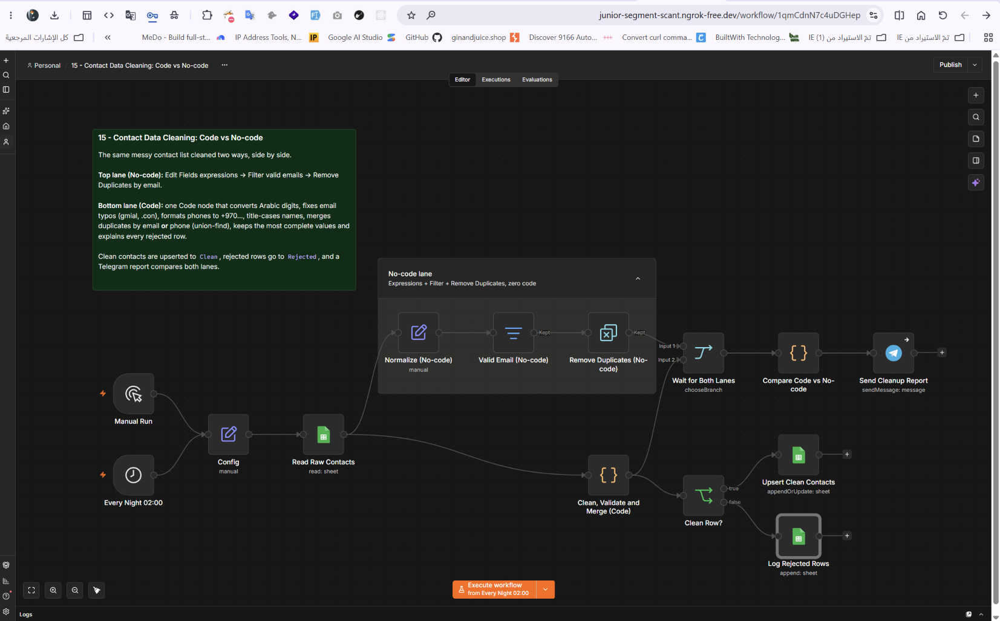

# تنظيف بيانات جهات الاتصال: كود أم بدون كود؟

Workflow لـ n8n يُشغَّل كل ليلة لتنظيف قائمة جهات الاتصال من Google Sheets بمسارين متوازيين: الأول بدون كود والثاني بالكود، ثم يرسل تقريرًا مقارنًا على Telegram.

## ماذا يفعل؟

1. يعمل تلقائيًا كل ليلة الساعة 2 صباحًا.
2. **المسار الأول (بدون كود):** ينظّف الاسم والبريد والهاتف، يحذف البريد غير الصالح، ويزيل التكرار حسب البريد.
3. **المسار الثاني (بالكود):** يحوّل الأرقام العربية، يصلح أخطاء البريد الشائعة (gmial، .con)، ينسّق رقم الهاتف بمفتاح الدولة، يدمج المكرر حسب البريد أو الهاتف مع الاحتفاظ بأكمل البيانات.
4. يحفظ جهات الاتصال النظيفة في ورقة منفصلة، والمرفوضة في ورقة أخرى مع سبب رفض كل صف.
5. يرسل تقريرًا على Telegram يقارن نتيجة المسارين بالأرقام.

## المتطلبات

- n8n وTelegram Bot API.
- Google Sheets OAuth2 لقراءة البيانات الخام وحفظ النتائج.
- إضافة Code Node في n8n لتشغيل مسار الكود.

## الإعداد

1. ارفع [`template.xlsx`](./templates/template.xlsx) إلى Google Drive وافتحه كـ Google Sheets.
2. الجدول يحتوي على: ورقة `Raw` للبيانات الخام، `Cleaned` للنظيفة، `Rejected` للمرفوضة.
3. استورد [`workflow.json`](./workflow.json) إلى n8n واربط بيانات اعتماد Google Sheets وTelegram.
4. في عقدة القراءة، اختر ملف Google Sheets المناسب وورقة `Raw`.
5. تحقق من جدولة التشغيل الليلي وعدّله حسب توقيتك.

## التشغيل والاختبار

- أضف بيانات خام تتضمن أخطاء إملائية في البريد وأرقامًا عربية وتكرارًا.
- شغّل الـ workflow يدويًا وقارن نتيجتي المسارين في Sheets.
- تحقق من ورقة `Rejected` وأسباب الرفض لكل صف.
- راجع تقرير Telegram للمقارنة بين المسارين.

## الصور والملفات

- [`workflow.json`](./workflow.json): ملف الاستيراد إلى n8n.
- [`caption-ar.txt`](./caption-ar.txt): نص المنشور العربي للمشروع.
- [`templates/template.xlsx`](./templates/template.xlsx): قالب جداول البيانات الخام والنظيفة والمرفوضة.
- [`screenshots/`](./screenshots/): صور الـ workflow والنتيجة.

> بيانات جهات الاتصال تُعالَج محليًا في n8n دون إرسالها إلى خدمات خارجية. تأكد من صلاحيات الوصول إلى Google Sheets قبل تشغيل الـ workflow في الإنتاج.
