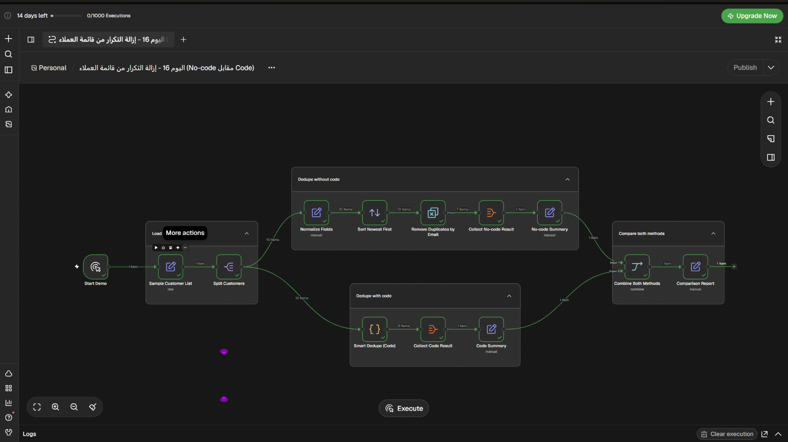

# إزالة التكرار من قائمة العملاء: بدون كود أم بالكود؟

Workflow تجريبي لـ n8n يقارن بين إزالة التكرار حسب البريد الإلكتروني فقط وبين دمج العملاء حسب البريد أو الهاتف، مع الاحتفاظ بأكمل بيانات من السجلات المتكررة.

## ماذا يفعل؟

1. يبدأ يدويًا ببيانات تجريبية فيها 10 سجلات عملاء.
2. ينظف البريد والهاتف ويوحّد صيغة الأرقام قبل المقارنة.
3. **بدون كود:** يستخدم Remove Duplicates حسب البريد ويحتفظ بأحدث سجل.
4. **بالكود:** يعتبر السجلين للعميل نفسه عند تطابق البريد أو الهاتف، ويدمج البيانات الناقصة من السجلات الأقدم.
5. يعرض تقريرًا يقارن النتيجتين: 7 عملاء بالطريقة الجاهزة مقابل 6 بالكود.

## المتطلبات

- n8n مع دعم Code Node.
- لا يحتاج هذا المثال إلى بيانات اعتماد خارجية؛ بيانات الاختبار مضمنة في الـ workflow.

## الإعداد

1. استورد [`workflow.json`](./workflow.json) إلى n8n.
2. راجع عقدة `Sample Customer List` لتعديل بيانات الاختبار إن رغبت.
3. لا توجد اتصالات أو بيانات اعتماد خارجية مطلوبة.

## التشغيل والاختبار

- شغّل الـ workflow يدويًا.
- قارن عدد العملاء في `No-code Summary` و`Code Summary`.
- تحقق من دمج سجل سارة ذي البريد المختلف ورقم الهاتف نفسه في نتيجة مسار الكود.

## الصور والملفات

- [`workflow.json`](./workflow.json): ملف الاستيراد إلى n8n.
- [`caption-ar.txt`](./caption-ar.txt): نص المنشور العربي للمشروع.
- [`screenshots/`](./screenshots/): صورة الـ workflow.
