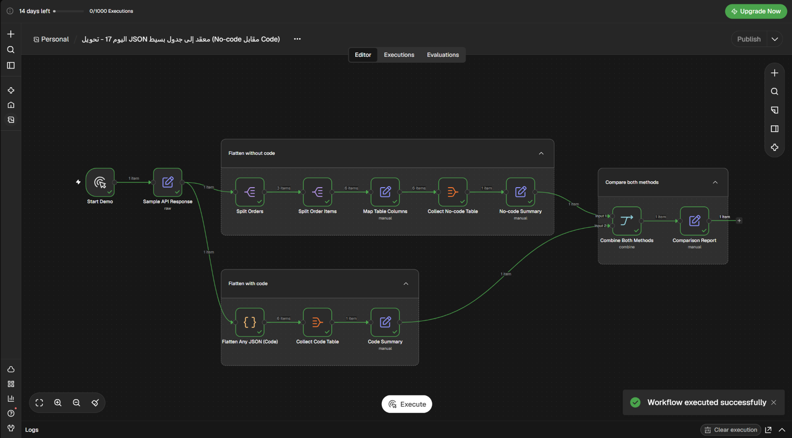

# تحويل JSON معقد إلى جدول: بدون كود أم بالكود؟

Workflow تجريبي لـ n8n يحوّل استجابة API متداخلة إلى جدول؛ كل منتج في الطلب يصبح صفًا مستقلًا مع تكرار معلومات الطلب.

## ماذا يفعل؟

1. يبدأ يدويًا باستجابة تجريبية فيها 3 طلبات و6 منتجات.
2. يفصل الطلبات ثم يفصل المنتجات داخل كل طلب.
3. **بدون كود:** يختار الأعمدة ويسميها يدويًا، لينتج جدولًا من 13 عمودًا.
4. **بالكود:** يمر على طبقات JSON ويحوّل الحقول تلقائيًا إلى أعمدة، لينتج 17 عمودًا.
5. يترك الحقول غير الموجودة فارغة ويعرض تقرير مقارنة بين الطريقتين.

## المتطلبات

- n8n مع دعم Code Node.
- لا يحتاج هذا المثال إلى بيانات اعتماد خارجية؛ بيانات الاختبار مضمنة في الـ workflow.

## الإعداد

1. استورد [`workflow.json`](./workflow.json) إلى n8n.
2. راجع عقدة `Sample API Response` لتعديل بيانات الاختبار إن رغبت.
3. لا توجد اتصالات أو بيانات اعتماد خارجية مطلوبة.

## التشغيل والاختبار

- شغّل الـ workflow يدويًا.
- تحقق من ظهور 6 صفوف، صف لكل منتج.
- قارن `No-code Summary` و`Code Summary`، وتحقق من أن الحقول غير الموجودة تظهر فارغة.

## الصور والملفات

- [`workflow.json`](./workflow.json): ملف الاستيراد إلى n8n.
- [`caption-ar.txt`](./caption-ar.txt): نص المنشور العربي للمشروع.
- [`screenshots/`](./screenshots/): صورة الـ workflow.
