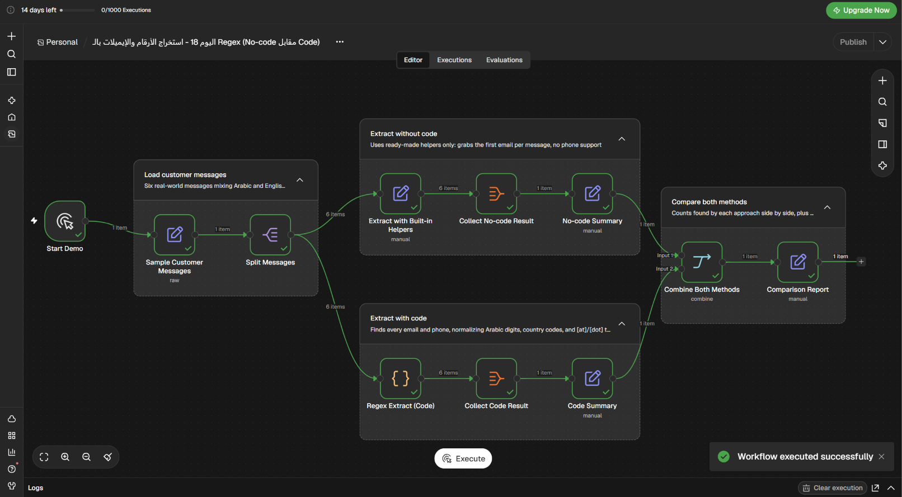

# استخراج الأرقام والإيميلات من الرسائل بـ Regex: بدون كود أم بالكود؟

Workflow تجريبي لـ n8n يقارن بين أدوات استخراج جاهزة وبين Regex مخصص لاستخراج بيانات التواصل من رسائل عربية وإنجليزية وبصيغ مختلفة.

## ماذا يفعل؟

1. يبدأ يدويًا بست رسائل تجريبية من مصادر وصيغ مختلفة.
2. **بدون كود:** يستخدم المساعدات الجاهزة لالتقاط أول بريد إلكتروني في الرسالة.
3. **بالكود:** يستخدم Regex لالتقاط كل الإيميلات والأرقام، ويفك صيغ الإيميل المخفي مثل `name [at] site [dot] com`.
4. يحوّل الأرقام العربية إلى أرقام عادية ويوحّد صيغة أرقام الهاتف.
5. يعرض تقرير مقارنة؛ المثال يلتقط 4 إيميلات و0 أرقام بدون كود، و6 إيميلات و5 أرقام بالكود.

## المتطلبات

- n8n مع دعم Code Node.
- لا يحتاج هذا المثال إلى بيانات اعتماد خارجية؛ بيانات الاختبار مضمنة في الـ workflow.

## الإعداد

1. استورد [`workflow.json`](./workflow.json) إلى n8n.
2. راجع عقدة `Sample Customer Messages` لتعديل بيانات الاختبار إن رغبت.
3. لا توجد اتصالات أو بيانات اعتماد خارجية مطلوبة.

## التشغيل والاختبار

- شغّل الـ workflow يدويًا.
- قارن الإيميلات والأرقام المستخرجة في `No-code Summary` و`Code Summary`.
- تحقق من تحويل الأرقام العربية وتوحيد أرقام الهاتف والإيميلات المخفية.

## الصور والملفات

- [`workflow.json`](./workflow.json): ملف الاستيراد إلى n8n.
- [`caption-ar.txt`](./caption-ar.txt): نص المنشور العربي للمشروع.
- [`screenshots/`](./screenshots/): صورة الـ workflow.
