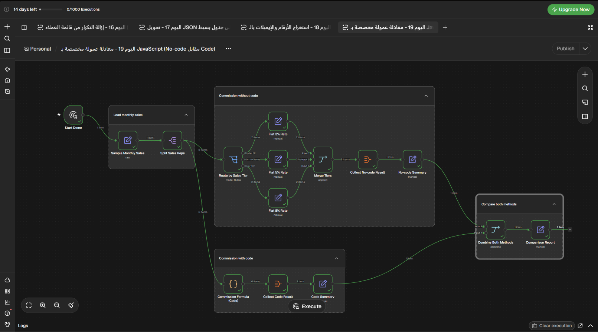

# معادلة عمولة مخصصة بـ JavaScript: بدون كود أم بالكود؟

Workflow تجريبي لـ n8n يقارن بين نسب عمولة ثابتة وبين سياسة عمولات تشمل شرائح تصاعدية ومكافآت وخصومات وحدًا أعلى.

## ماذا يفعل؟

1. يبدأ يدويًا ببيانات مبيعات شهرية لستة مندوبين.
2. **بدون كود:** يوزع المندوبين على شرائح بنسبة ثابتة 3% أو 5% أو 8% من المبيعات.
3. **بالكود:** يحسب العمولة على صافي المبيعات بعد المرتجعات، مع 3% لأول 5,000 ثم نسبة أعلى لما يتجاوزها.
4. يضيف مكافأة 200 عند جلب 3 عملاء جدد أو أكثر، ويخفض العمولة للنصف إذا تجاوزت المرتجعات 10%، ويطبق سقفًا شهريًا قدره 2,000.
5. يعرض تقرير مقارنة؛ في البيانات التجريبية يبلغ الإجمالي 5,121 بالطريقة الثابتة مقابل 3,719 وفق سياسة الشركة.

## المتطلبات

- n8n مع دعم Code Node.
- لا يحتاج هذا المثال إلى بيانات اعتماد خارجية؛ بيانات الاختبار مضمنة في الـ workflow.

## الإعداد

1. استورد [`workflow.json`](./workflow.json) إلى n8n.
2. راجع عقدة `Sample Monthly Sales` أو عقدة `Commission Formula (Code)` لتعديل بيانات الاختبار والسياسة.
3. لا توجد اتصالات أو بيانات اعتماد خارجية مطلوبة.

## التشغيل والاختبار

- شغّل الـ workflow يدويًا.
- قارن إجمالي العمولات وتفاصيل كل مندوب في `No-code Summary` و`Code Summary`.
- تحقق من أثر الشرائح والمكافآت والمرتجعات والسقف على النتائج.

## الصور والملفات

- [`workflow.json`](./workflow.json): ملف الاستيراد إلى n8n.
- [`caption-ar.txt`](./caption-ar.txt): نص المنشور العربي للمشروع.
- [`screenshots/`](./screenshots/): صورة الـ workflow.
