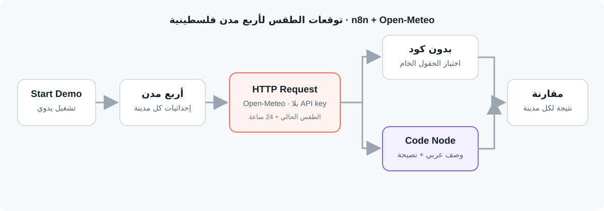

# ربط أي API عبر HTTP Request: بدون كود أم بالكود؟

Workflow لـ n8n يجلب توقعات الطقس لأربع مدن فلسطينية من خدمة Open-Meteo العامة، دون مفتاح API، ثم يقارن بين اختيار الحقول الجاهزة ومعالجة التوقعات بالكود.

## ماذا يفعل؟

1. يبدأ يدويًا بأربع مدن وإحداثياتها: غزة، رام الله، نابلس، والخليل.
2. يرسل طلب HTTP إلى Open-Meteo لكل مدينة للحصول على الطقس الحالي والساعات الـ24 الكاملة القادمة.
3. **بدون كود:** يختار المدينة ودرجة الحرارة وسرعة الرياح ورمز الطقس مباشرة من الاستجابة.
4. **بالكود:** يحوّل رمز الطقس إلى وصف عربي، ويحسب أدنى وأعلى حرارة وأعلى احتمال للمطر وأفضل ساعة متاحة للخروج خلال الـ24 ساعة القادمة.
5. يضيف نصيحة مناسبة، ثم يعرض تقرير مقارنة للطريقتين لكل مدينة.

## المتطلبات

- n8n مع دعم HTTP Request وCode Node.
- اتصال بالإنترنت للوصول إلى [واجهة Open-Meteo](https://open-meteo.com/).
- لا يلزم مفتاح API أو بيانات اعتماد خارجية لهذا المثال.

## الإعداد

1. استورد [`workflow.json`](./workflow.json) إلى n8n.
2. شغّل عقدة `Start Demo` يدويًا؛ إحداثيات المدن موجودة في `City List`.
3. إذا عدّلت أسماء الحقول أو الإحداثيات، تأكد من تحديث عقدة `Map Basic Fields` عند الحاجة.
4. تستخدم الطلبات المنطقة الزمنية `Asia/Jerusalem`؛ ويختار الكود الساعات الـ24 الكاملة القادمة حتى لا يقترح ساعة مضت.

## التشغيل والاختبار

- شغّل الـ workflow مع اتصال إنترنت، وتأكد من ظهور نتيجة لكل مدينة.
- في `Map Basic Fields` راجع درجة الحرارة وسرعة الرياح ورمز الطقس الخام.
- في `Interpret Weather (Code)` راجع الوصف العربي وأدنى وأعلى حرارة واحتمال المطر والساعة المقترحة والنصيحة للساعات الـ24 القادمة.
- افتح `Comparison Report` لمقارنة المسارين لكل مدينة. تتغير النتائج حسب وقت التشغيل وتحديثات خدمة الطقس.

## الصور والملفات

- [`workflow.json`](./workflow.json): ملف الاستيراد إلى n8n.
- [`caption-ar.txt`](./caption-ar.txt): نص المنشور العربي للمشروع.
- [`screenshots/workflow-overview.svg`](./screenshots/workflow-overview.svg): رسم توضيحي لمسار الـ workflow.

> يستخدم المثال واجهة طقس عامة عبر الإنترنت، ويرسل إليها إحداثيات المدن فقط. راجع شروط استخدام الخدمة وتأكد من اتصال n8n بالإنترنت.
