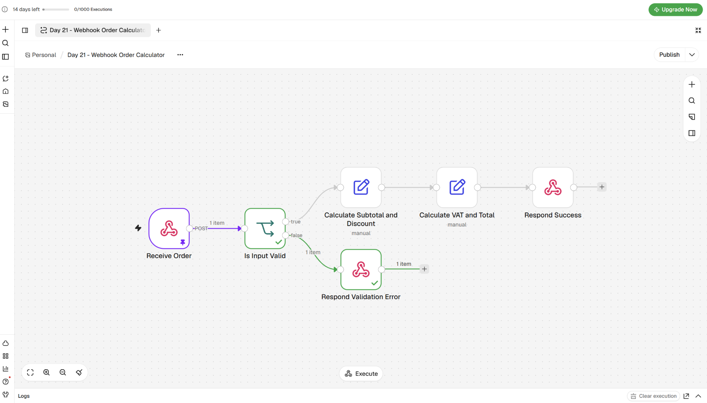

# حاسبة طلبات عبر Webhook

Workflow لـ n8n يستقبل طلبات شراء من أي موقع أو تطبيق عبر Webhook، يتحقق من صحة البيانات، يحسب المجموع والخصم والضريبة، ويرجع فاتورة جاهزة فورًا.

## ماذا يفعل؟

1. يستقبل طلب شراء عبر Webhook يحتوي على اسم العميل والمنتجات بأسعارها وكمياتها وكود خصم اختياري.
2. يتحقق من صحة الطلب: لو ناقص بيانات، أو الكمية صفر، أو السعر بالسالب، يرجع رد خطأ واضح (400).
3. لو الطلب سليم، يحسب مجموع المنتجات قبل الخصم.
4. لو كود الخصم `SAVE10` موجود، يخصم 10%.
5. يضيف ضريبة 14%، ويحسب الإجمالي النهائي.
6. يرجع الرد فورًا: عدد المنتجات، المجموع، الخصم، الضريبة، الإجمالي، ووقت المعالجة.

## المتطلبات

- n8n مع دعم Webhook وCode Node.
- لا يحتاج هذا المثال إلى بيانات اعتماد خارجية؛ بيانات الاختبار تُرسل مباشرة عبر الـ Webhook.

## الإعداد

1. استورد [`workflow.json`](./workflow.json) إلى n8n.
2. فعّل الـ workflow لتفعيل رابط الـ Webhook.
3. أرسل طلب تجريبي عبر أي أداة HTTP (مثل curl أو Postman) إلى رابط الـ Webhook.

## التشغيل والاختبار

- أرسل طلبًا يحتوي منتجين (مثلاً: 2 بسعر 50 و1 بسعر 30) مع كود `SAVE10`.
- تحقق من أن المجموع 130، الخصم 13، الضريبة 16.38، والإجمالي 133.38.
- أرسل طلبًا ناقصًا وتأكد من رجوع خطأ 400 مع شرح واضح.

## الصور والملفات

- [`workflow.json`](./workflow.json): ملف الاستيراد إلى n8n.
- [`caption-ar.txt`](./caption-ar.txt): نص المنشور العربي للمشروع.
- [`screenshots/`](./screenshots/): صورة الـ workflow.
