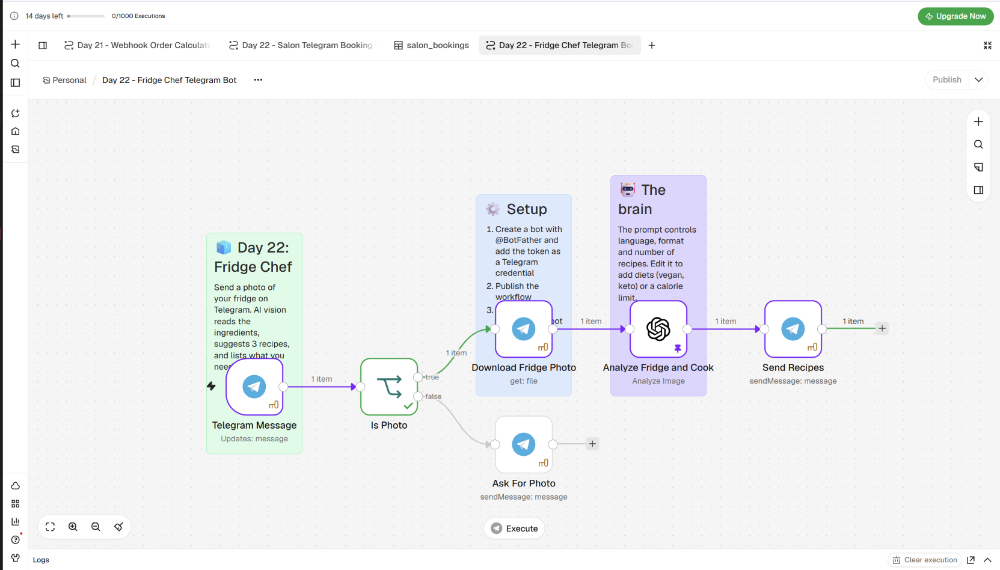

# شيف الثلاجة: صوّر ثلاجتك وخذ 3 وصفات

Workflow لـ n8n يستقبل صورة الثلاجة عبر بوت Telegram، يحللها بالذكاء الاصطناعي لتحديد المكونات المتاحة، ويقترح 3 وصفات مرتبة من الأسهل للأصعب مع قائمة تسوق بالناقص.

## ماذا يفعل؟

1. يستقبل صورة من المستخدم عبر بوت Telegram.
2. لو المستخدم أرسل نصًا بدل صورة، يرد عليه ويطلب صورة.
3. يحمّل الصورة بأعلى دقة ويرسلها للذكاء الاصطناعي.
4. الذكاء الاصطناعي يقرأ الصورة ويعدّد المكونات الظاهرة بوضوح.
5. يقترح 3 وصفات من المكونات الموجودة، مرتبة من الأسهل للأصعب، مع اسم كل وصفة ووقت الطبخ وخطوتين مختصرتين.
6. يعطي قائمة بالمكونات الناقصة ولأي وصفة تحتاجها.
7. ينصح بالأكل الذي قد يفسد أولًا لتجنب الهدر.
8. لو الصورة ليست ثلاجة أو أكل، يخبر المستخدم بلطف ويطلب صورة أخرى.

## المتطلبات

- n8n مع دعم Telegram Bot وAI Node.
- Telegram Bot وبيانات اعتماد Telegram Bot API.
- بيانات اعتماد نموذج ذكاء اصطناعي يدعم تحليل الصور (مثل Gemini).

## الإعداد

1. استورد [`workflow.json`](./workflow.json) إلى n8n.
2. اربط بيانات اعتماد Telegram Bot ونموذج الذكاء الاصطناعي.
3. تأكد من أن البوت يستقبل الرسائل (اضغط Start على البوت من Telegram).

## التشغيل والاختبار

- أرسل صورة ثلاجة للبوت على Telegram وانتظر الرد.
- تحقق من أن الوصفات مبنية فقط على المكونات الظاهرة في الصورة.
- أرسل نصًا بدل صورة وتأكد من أن البوت يطلب صورة.
- أرسل صورة غير متعلقة بالأكل وتأكد من الرد المناسب.

## الصور والملفات

- [`workflow.json`](./workflow.json): ملف الاستيراد إلى n8n.
- [`caption-ar.txt`](./caption-ar.txt): نص المنشور العربي للمشروع.
- [`screenshots/`](./screenshots/): صورة الـ workflow.
