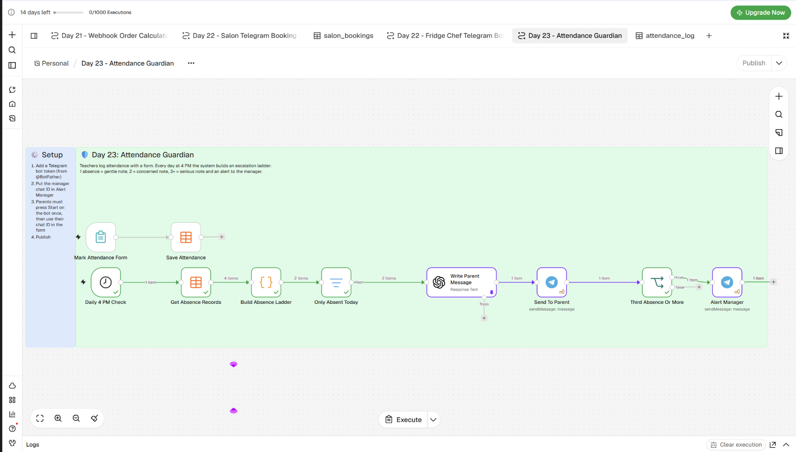

# حارس الحضور: غياب الطالب يوصل لولي أمره تلقائيًا

Workflow لـ n8n يتابع حضور وغياب الطلاب، يصنّف الغيابات على 3 درجات، يرسل رسائل عربية مناسبة لأولياء الأمور عبر Telegram، وينبّه المدير عند الغياب المتكرر.

## ماذا يفعل؟

1. يستقبل تسجيل الحضور عبر فورم بسيط: اسم الطالب، الصف، رقم Telegram لولي الأمر، الحالة (حاضر أو غائب أو متأخر)، والتاريخ.
2. يحفظ جميع التسجيلات في جدول داخل n8n.
3. كل يوم الساعة 4 العصر، يراجع غيابات آخر 7 أيام لكل طالب.
4. يرتّب الطلاب على سلم من 3 درجات حسب عدد الغيابات.
5. يكتب رسالة عربية لولي الأمر بنبرة تناسب الدرجة ويرسلها عبر Telegram.
6. الرسالة محترمة ومختصرة، لا تلوم الطالب ولا ولي الأمر، ولا تخترع سبب الغياب.
7. عند الغياب الثالث أو أكثر، يرسل تنبيهًا إضافيًا لمدير المركز يحتوي اسم الطالب وصفه وتواريخ الغياب مع توصية باتصال هاتفي.

## المتطلبات

- n8n مع دعم Telegram Bot وSchedule Trigger.
- Telegram Bot وبيانات اعتماد Telegram Bot API.
- معرّف محادثة Telegram لمدير المركز.
- كل ولي أمر يجب أن يضغط Start على البوت مرة واحدة قبل استقبال الرسائل.

## الإعداد

1. استورد [`workflow.json`](./workflow.json) إلى n8n.
2. أنشئ بوت من @BotFather وأدخل التوكن في بيانات اعتماد Telegram.
3. أدخل رقم محادثة المدير في عقدة Alert Manager.
4. تأكد من أن أولياء الأمور ضغطوا Start على البوت، ثم أدخل أرقامهم في الفورم.

## التشغيل والاختبار

- سجّل حضور عدة طلاب عبر الفورم بحالات مختلفة (حاضر، غائب، متأخر).
- شغّل الـ workflow يدويًا أو انتظر الساعة 4 العصر.
- تحقق من وصول الرسائل لأولياء الأمور بالنبرة المناسبة لدرجة الغياب.
- تأكد من وصول تنبيه المدير عند الغياب الثالث.

## الصور والملفات

- [`workflow.json`](./workflow.json): ملف الاستيراد إلى n8n.
- [`caption-ar.txt`](./caption-ar.txt): نص المنشور العربي للمشروع.
- [`screenshots/`](./screenshots/): صورة الـ workflow.
