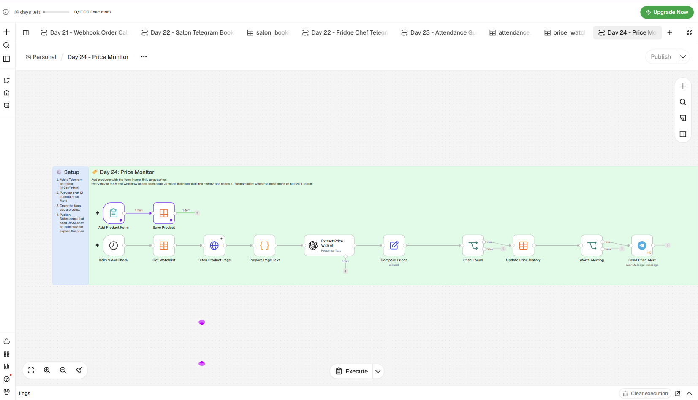

# مراقب الأسعار: أضف رابط المنتج وانتظر التنبيه

Workflow لـ n8n يراقب أسعار المنتجات يوميًا، يقارن السعر الحالي بالسعر المستهدف، ويرسل تنبيهًا عبر Telegram عند انخفاض السعر أو وصوله للسعر المطلوب.

## ماذا يفعل؟

1. يستقبل المنتجات عبر فورم بسيط: اسم المنتج، رابطه، والسعر المستهدف.
2. يحفظ المنتجات في قائمة مراقبة داخل n8n.
3. كل يوم الساعة 9 الصبح، يفتح صفحة كل منتج في القائمة.
4. يقص من الصفحة الأجزاء التي تحتوي السعر ويعطيها للذكاء الاصطناعي.
5. الذكاء الاصطناعي يقرأ السعر الحالي ويتجاهل السعر القديم المشطوب.
6. لو لم يجد سعرًا، يتخطى المنتج دون التأثير على القائمة.
7. يسجّل آخر سعر وأقل سعر وصل إليه المنتج.
8. لو السعر انخفض عن آخر فحص أو وصل للسعر المستهدف، يرسل تنبيهًا عبر Telegram.

## المتطلبات

- n8n مع دعم HTTP Request وAI Node وSchedule Trigger.
- Telegram Bot وبيانات اعتماد Telegram Bot API.
- اتصال بالإنترنت للوصول إلى صفحات المنتجات.
- بيانات اعتماد نموذج ذكاء اصطناعي لقراءة الأسعار من الصفحات.

## الإعداد

1. استورد [`workflow.json`](./workflow.json) إلى n8n.
2. أنشئ بوت من @BotFather وأدخل التوكن في بيانات اعتماد Telegram.
3. أدخل رقم محادثتك في عقدة Send Price Alert.
4. افتح الفورم وأضف منتجًا، ثم انشر الـ workflow.

## التشغيل والاختبار

- أضف منتجًا عبر الفورم وشغّل الـ workflow يدويًا.
- تحقق من وصول التنبيه عبر Telegram بالمعلومات الصحيحة: اسم المنتج، السعر الحالي، السعر السابق، السعر المستهدف، أقل سعر مسجّل، ورابط المنتج.
- تأكد من أن التنبيه يفرّق بين "نزل السعر" و"وصل للسعر المستهدف".

## الصور والملفات

- [`workflow.json`](./workflow.json): ملف الاستيراد إلى n8n.
- [`caption-ar.txt`](./caption-ar.txt): نص المنشور العربي للمشروع.
- [`screenshots/`](./screenshots/): صورة الـ workflow.

> الصفحات التي تحتاج تسجيل دخول أو تحمّل السعر بـ JavaScript قد لا يظهر فيها السعر للنظام. جرّب رابط المنتج قبل الاعتماد عليه.
