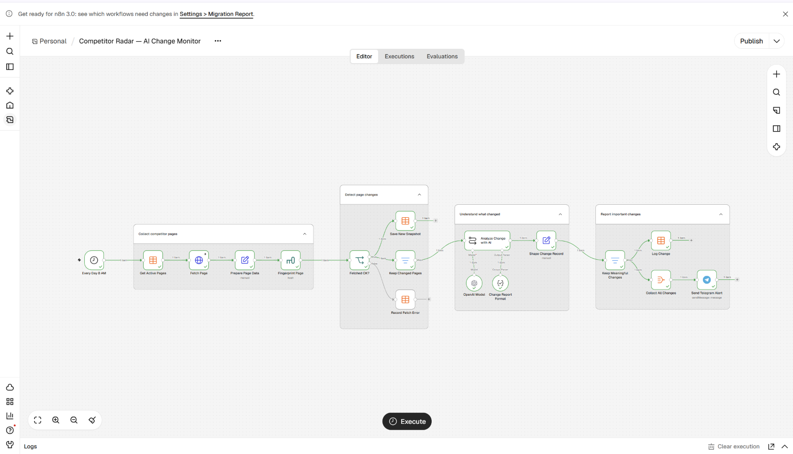

# رادار المنافسين: تابع تغييرات مواقعهم

Workflow لـ n8n يراجع صفحات المنافسين يوميًا، يقارن محتواها بآخر نسخة، ويستخدم الذكاء الاصطناعي لتلخيص التغييرات المهمة وإرسال تقرير واحد إلى Telegram.

## ماذا يفعل؟

1. يقرأ الصفحات المفعّلة من جدول `competitor_pages`.
2. يفتح كل صفحة ويحفظ نصها وبصمتها الرقمية.
3. يتخطى الصفحة إذا لم يتغير محتواها عن آخر فحص.
4. يرسل النسخة القديمة والجديدة إلى الذكاء الاصطناعي عند وجود تغيير.
5. يتجاهل التغييرات الشكلية، ويصنّف التغييرات المهمة حسب النوع والأهمية.
6. يسجل التغييرات المهمة في `competitor_changes` ويرسلها مجمعة برسالة واحدة على Telegram.
7. يسجل خطأ الصفحة ويتابع بقية الصفحات إذا تعذّر جلبها.

## المتطلبات

- n8n مع دعم Data Tables وSchedule Trigger وHTTP Request وCrypto وAI Chain.
- بيانات اعتماد OpenAI وTelegram Bot API.
- وصول n8n إلى صفحات المنافسين المراد مراقبتها.

## الإعداد

1. استورد [`workflow.json`](./workflow.json) إلى n8n.
2. اربط بيانات اعتماد OpenAI وTelegram.
3. أنشئ جدول `competitor_pages` بالأعمدة `competitor_name` و`page_url` و`page_type` و`is_active` و`last_hash` و`last_snapshot` و`last_checked_at` و`last_error`. أضف صفًا لكل صفحة؛ فعّل `is_active`، واترك حقول النسخة السابقة فارغة بالبداية.
4. أنشئ جدول `competitor_changes` بالأعمدة `competitor_name` و`page_url` و`change_type` و`importance` و`summary` و`recommendation` و`detected_at`.
5. في عقد Data Table، اختر الجدولين اللذين أنشأتهما بدل مراجع الجداول الموجودة في نسخة التصدير.
6. استبدل `YOUR_TELEGRAM_CHAT_ID` في عقدة `Send Telegram Alert` بمعرّف محادثتك.
7. راجع المنطقة الزمنية ووقت `Every Day 8 AM`، ثم فعّل الـ workflow.

## التشغيل والاختبار

- شغّل الـ workflow يدويًا وتأكد من حفظ بصمة ونص كل صفحة في `competitor_pages`.
- التشغيل الأول يحفظ النسخة الأولى فقط؛ تبدأ مقارنة التغييرات من التشغيل التالي.
- عدّل محتوى صفحة اختبار وشغّل workflow مرة أخرى، ثم تحقق من تسجيل التغيير المهم ووصول تقرير Telegram.
- جرّب رابطًا غير متاح وتأكد من تسجيل الخطأ دون إيقاف متابعة بقية الصفحات.

## الصور والملفات

- [`workflow.json`](./workflow.json): ملف الاستيراد إلى n8n.
- [`caption-ar.txt`](./caption-ar.txt): نص المنشور العربي للمشروع.
- [`screenshots/`](./screenshots/): صورة الـ workflow.

> راجع شروط المواقع قبل مراقبتها، وتأكد من أن محتواها متاح لجلبه. التغييرات التي يحددها الذكاء الاصطناعي ملخصات مساعدة وليست تحققًا مستقلًا من المعلومات.
