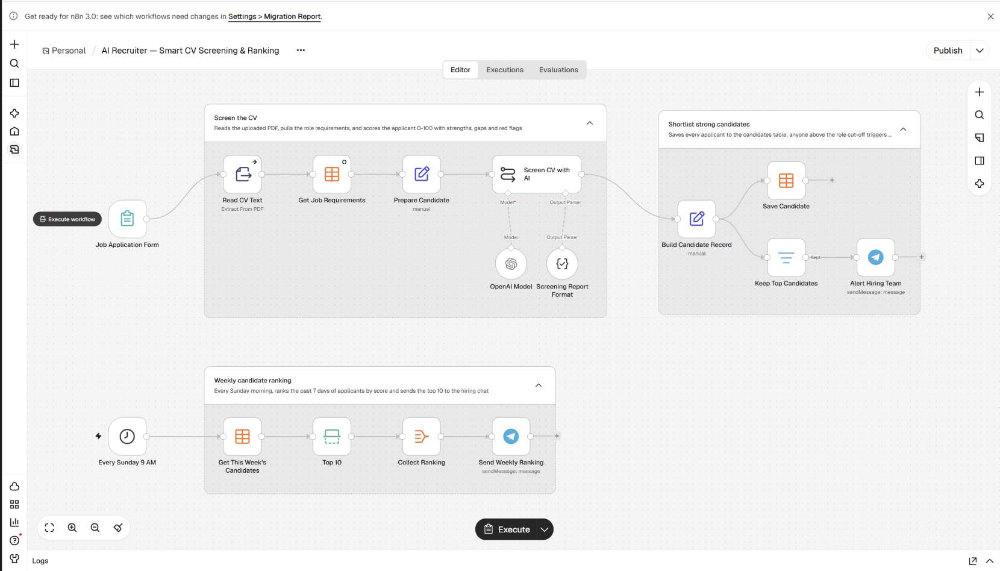

# مسؤول التوظيف بالذكاء الاصطناعي: فرز السير الذاتية وترتيبها

Workflow لـ n8n يستقبل طلبات التوظيف وسيرًا ذاتية بصيغة PDF، يقارنها بمتطلبات الوظيفة، ويحفظ ملخصًا وتقييمًا لمساعدة فريق التوظيف على المراجعة.

## ماذا يفعل؟

1. يستقبل بيانات المتقدم وملف سيرته الذاتية عبر فورم.
2. يستخرج نص السيرة الذاتية ويحمّل متطلبات الوظيفة من جدول `job_openings`.
3. يطلب من الذكاء الاصطناعي تقييم المطابقة من 100: 60% للمتطلبات الأساسية، و20% لعمق الخبرة، و20% للمزايا الإضافية.
4. يسجل نقاط القوة والفجوات والمهارات المطابقة والتنبيهات وأسئلة مقابلة مقترحة في جدول `candidates`.
5. يرسل تنبيهًا لفريق التوظيف عند بلوغ المتقدم الحد الأدنى المحدد للوظيفة.
6. يرسل كل أحد ترتيب أفضل 10 متقدمين من آخر 7 أيام.

## المتطلبات

- n8n مع دعم Form Trigger وExtract From File وData Tables وSchedule Trigger وAI Chain.
- بيانات اعتماد OpenAI وTelegram Bot API.
- جدولان في n8n: `job_openings` و`candidates`.

## الإعداد

1. استورد [`workflow.json`](./workflow.json) إلى n8n.
2. اربط بيانات اعتماد OpenAI وTelegram.
3. جهّز `job_openings` بالأعمدة `job_title` و`requirements` و`nice_to_have` و`min_score`. يجب أن يطابق `job_title` أحد الخيارات في الفورم؛ الحد الافتراضي للتنبيه 75.
4. أنشئ أو اختر جدول `candidates` بأعمدة بيانات المتقدم والتقييم، ومنها `full_name` و`email` و`phone` و`job_title` و`years_experience` و`score` و`verdict` و`matched_skills` و`strengths` و`gaps` و`red_flags` و`summary` و`interview_questions` و`cv_file_name` و`status` و`applied_at`.
5. في عقد Data Table، اختر الجدولين اللذين أنشأتهما بدل مراجع الجداول الموجودة في نسخة التصدير.
6. استبدل `YOUR_TELEGRAM_CHAT_ID` في عقدتي `Alert Hiring Team` و`Send Weekly Ranking` بمعرّف محادثة فريق التوظيف.
7. راجع خيارات الوظائف في `Job Application Form` لتطابق سجلات `job_openings`، ثم اختبر الفورم قبل نشره.

## التشغيل والاختبار

- أضف متطلبات وظيفة وحدًا أدنى للدرجة في `job_openings`، ثم أرسل طلبًا تجريبيًا بملف PDF قابل لاستخراج النص.
- تحقق من حفظ التقييم والتفاصيل في `candidates`، ومن وصول التنبيه عند تجاوز الحد المحدد.
- اختبر ملفًا غير قابل لاستخراج النص منه، وتأكد من مراجعة التنبيه الناتج قبل الاعتماد على التقييم.
- شغّل مسار الترتيب الأسبوعي يدويًا للتحقق من ترتيب المتقدمين.

## الصور والملفات

- [`workflow.json`](./workflow.json): ملف الاستيراد إلى n8n.
- [`caption-ar.txt`](./caption-ar.txt): نص المنشور العربي للمشروع.
- [`screenshots/`](./screenshots/): صورة الـ workflow.

> التقييم أداة مساعدة للمراجعة وليس قرار توظيف. راجع كل طلب بشريًا، وقيّد الوصول إلى السير الذاتية والبيانات الشخصية؛ إذ تُرسل نصوصها إلى مزود الذكاء الاصطناعي وتُحفظ نتائج التقييم في n8n.
