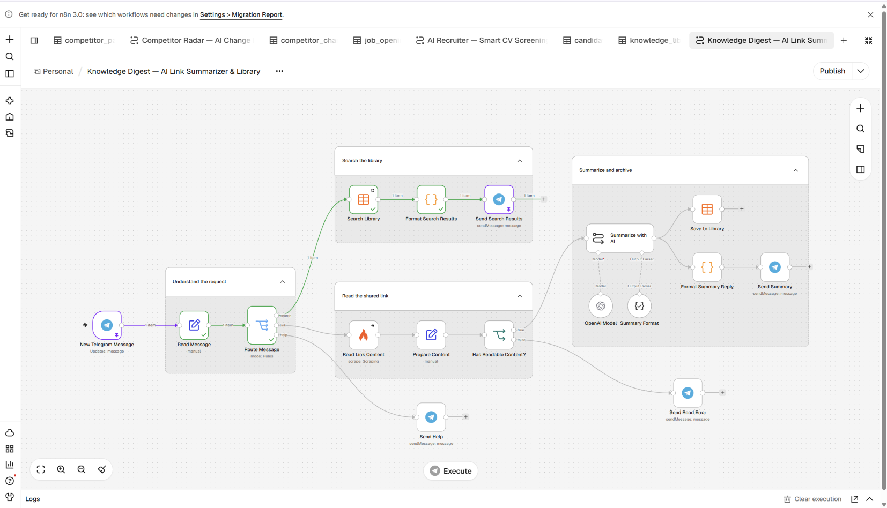

# مكتبة المعرفة: لخّص الروابط وابحث فيها

بوت Telegram مبني بـ n8n يستقبل رابط مقال أو فيديو YouTube، يجلب المحتوى المتاح، يلخصه بالعربية ويحفظه في مكتبة قابلة للبحث.

## ماذا يفعل؟

1. يستقبل رابطًا أو أمر بحث من Telegram.
2. يجلب محتوى الرابط باستخدام Firecrawl؛ وإذا لم يتوفر نص كافٍ، يرسل تنبيهًا بدل اختلاق ملخص.
3. يلخص المحتوى بالعربية في 3 إلى 5 جمل، مع أهم النقاط والاقتباسات والوسوم وخطوات عملية.
4. يحفظ الملخص ورابط المصدر في جدول `knowledge_library`.
5. يبحث عن كلمة في العنوان أو الملخص أو النقاط أو الوسوم، ويرجع آخر النتائج المطابقة.

## المتطلبات

- n8n مع دعم Telegram Trigger وTelegram وData Tables وFirecrawl وAI Chain.
- بيانات اعتماد Telegram Bot API وFirecrawl وOpenAI.
- جدول `knowledge_library` في n8n.

## الإعداد

1. استورد [`workflow.json`](./workflow.json) إلى n8n.
2. اربط بيانات اعتماد Telegram وFirecrawl وOpenAI.
3. أنشئ جدول `knowledge_library` بالأعمدة `title` و`source_url` و`source_type` و`language` و`summary` و`key_points` و`quotes` و`tags` و`action_items` و`chat_id` و`saved_at`.
4. في عقد Data Table، اختر الجدول الذي أنشأته بدل مراجع الجدول الموجودة في نسخة التصدير.
5. استبدل `YOUR_TELEGRAM_CHAT_ID` في إعدادات `New Telegram Message` بمعرّف محادثتك للسماح للبوت باستقبال رسائلك فقط.
6. فعّل الـ workflow، واضغط Start على البوت في Telegram.

## التشغيل والاختبار

- أرسل رابط مقال عام أو فيديو YouTube وتأكد من وصول ملخص وحفظه في المكتبة.
- أرسل `ابحث` متبوعة بكلمة، مثل `ابحث تسويق`، وتحقق من ظهور النتائج المطابقة.
- جرّب رابطًا محميًا أو بلا نص كافٍ وتأكد من وصول رسالة توضح تعذر القراءة.
- في فيديو YouTube، تحقق من أن الملخص يوضح إن كان المصدر المتاح هو وصف الفيديو فقط.

## الصور والملفات

- [`workflow.json`](./workflow.json): ملف الاستيراد إلى n8n.
- [`caption-ar.txt`](./caption-ar.txt): نص المنشور العربي للمشروع.
- [`screenshots/`](./screenshots/): صورة الـ workflow.

> أرسل للبوت روابط ومحتوى مسموحًا لك باستخدامه، وراجع الملخص والاقتباسات مقابل المصدر قبل إعادة نشرها. يتطلب استخراج محتوى بعض الصفحات اتصالًا وحساب Firecrawl صالحًا.
