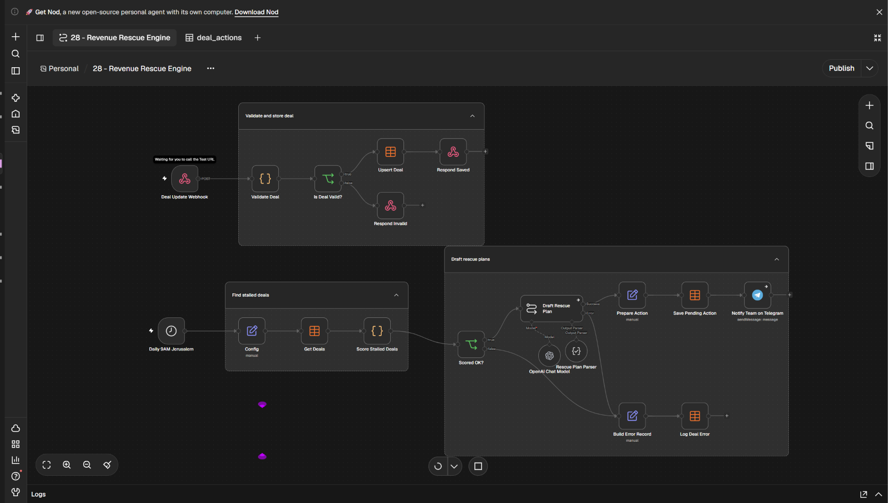

# محرك إنقاذ الصفقات: تابع قبل أن تضيع الفرصة

نظام في n8n يستقبل تحديثات الصفقات عبر Webhook، يحفظها برقم فريد، ويراجع يوميًا الصفقات المفتوحة التي توقفت متابعتها. يحسب أولوية ثابتة قابلة للتفسير، ثم يستخدم الذكاء الاصطناعي لتجهيز توصية ومسودة متابعة للمراجعة البشرية.

## ماذا يفعل؟

1. يستقبل تحديث الصفقة ويتحقق من رقمها ومرحلتها ومبلغها وبريد العميل وتاريخ آخر نشاط.
2. ينقح أنماطًا معروفة من أرقام البطاقات وأسرار الوصول في الملاحظات قبل حفظها.
3. يضيف الصفقة إلى جدول `deals` أو يحدثها باستخدام `deal_id`.
4. كل يوم الساعة 9 صباحًا بتوقيت القدس، يبحث عن الصفقات المفتوحة الخاملة 7 أيام أو أكثر.
5. يحسب أولوية من 100 وفق مدة التوقف وقيمة الصفقة ومرحلتها؛ لا يغيّر الذكاء الاصطناعي هذه الدرجة.
6. يولّد توصية ومسودة بريد، ويحفظها بحالة `pending_review` ويرسل ملخصًا للفريق.
7. لا يرسل أي بريد للعميل تلقائيًا، ويسجل أخطاء معالجة الصفقة دون إيقاف بقية التشغيل.

## المتطلبات

- n8n مع دعم Webhook وData Tables وSchedule Trigger وCode.
- بيانات اعتماد OpenAI وTelegram Bot API.
- جدولان في n8n: `deals` و`deal_actions`.

## الإعداد

1. استورد [`workflow.json`](./workflow.json) إلى n8n.
2. اربط بيانات اعتماد OpenAI وTelegram.
3. أنشئ جدول `deals` بالأعمدة `deal_id` و`customer_name` و`customer_email` و`stage` و`amount` و`currency` و`last_activity_at` و`next_step` و`notes` و`received_at`.
4. أنشئ جدول `deal_actions` بالأعمدة `deal_id` و`customer_name` و`stage` و`amount` و`days_inactive` و`priority_score` و`risk_level` و`reason` و`recommended_action` و`draft_subject` و`draft_message` و`confidence` و`status` و`error_message` و`created_at`.
5. في عقد Data Table، اختر الجدولين اللذين أنشأتهما بدل معرّفات الجدول المرفقة في التصدير.
6. استبدل `YOUR_TELEGRAM_CHAT_ID` في عقدة `Config` بمعرّف محادثة الفريق، واضبط الحد الأدنى لأيام الخمول وقيمة الصفقة العالية عند الحاجة.
7. تأكد أن المنطقة الزمنية للـ workflow هي `Asia/Jerusalem`. فعّل الـ workflow بعد الاختبار فقط.
8. أضف مصادقة أو حماية مناسبة للـ Webhook قبل نشر رابط الإنتاج، ولا تمرر بيانات حساسة في الملاحظات.

## التشغيل والاختبار

أرسل طلب POST إلى مسار `revenue-rescue-deal-update` ببيانات اختبار مثل:

```json
{
  "deal_id": "DEMO-001",
  "customer_name": "عميل تجريبي",
  "customer_email": "demo@example.com",
  "stage": "proposal",
  "amount": 50000,
  "currency": "ILS",
  "last_activity_at": "2026-10-01T10:00:00Z",
  "next_step": "متابعة العرض",
  "notes": "طلب مراجعة العرض"
}
```

- تحقق من رد نجاح الـ Webhook ومن حفظ الصفقة دون تكرار عند إرسال `deal_id` نفسه.
- أرسل بيانات ناقصة وتأكد من رجوع أخطاء تحقق واضحة.
- شغّل المسار اليومي يدويًا وتحقق من حساب الأولوية، حفظ مسودة المتابعة، ووصول ملخص Telegram.
- تأكد أن المسودة تبقى للمراجعة ولا تُرسل للعميل.

## الصور والملفات



- [`workflow.json`](./workflow.json): استقبال الصفقات وتحليلها اليومي.
- [`caption-ar.txt`](./caption-ar.txt): نص المنشور العربي للمشروع.
- [`screenshots/`](./screenshots/): صورة الـ workflow.

> التنقيح يلتقط أنماطًا معروفة فقط ولا يضمن إزالة كل المعلومات الحساسة. راجع البيانات وسياسة الاحتفاظ بها، ولا تعتمد على تقييم الذكاء الاصطناعي دون مراجعة بشرية.
