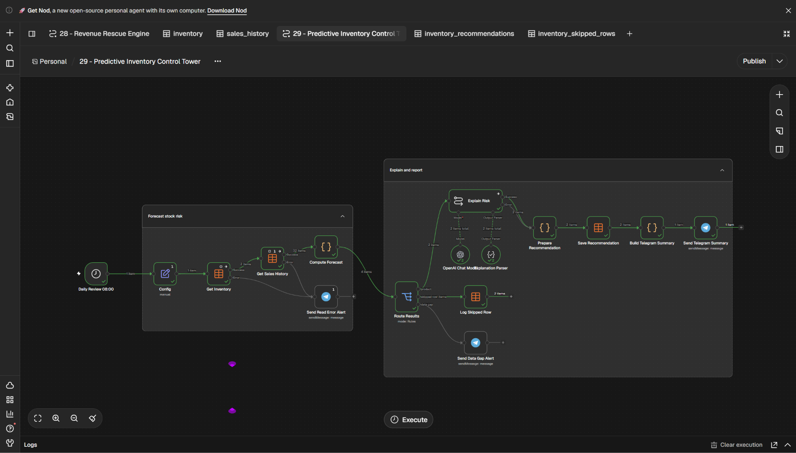

# برج مراقبة المخزون: توقّع النقص قبل حدوثه

Workflow يومي في n8n يحلل المخزون والمبيعات، يقدّر تغطية المخزون ونقطة إعادة الطلب، ويسجل توصيات قابلة للتفسير. يشرح الذكاء الاصطناعي النتائج فقط؛ الحسابات لا تعتمد عليه، ولا يصدر النظام أوامر شراء.

## ماذا يفعل؟

1. يقرأ المنتجات الفعّالة ومبيعات آخر 90 يومًا من جداول n8n.
2. يتحقق من الصفوف ويتخطى البيانات غير الصالحة مع تسجيل سبب التجاوز.
3. يقارن متوسط الطلب اليومي لآخر 7 أيام وآخر 30 يومًا ويحدد اتجاهه.
4. يحسب توقع 7 أيام، وأيام تغطية المخزون، ونقطة إعادة الطلب والكمية المقترحة.
5. يميز بين خطر النفاد والمنتجات الراكدة أو ذات الطلب الصفري.
6. يضيف شرحًا عربيًا للمراجعة؛ الأرقام تبقى ناتجة عن معادلات ثابتة.
7. يحفظ التوصية بحالة `pending_approval` ويرسل ملخصًا واحدًا عبر Telegram.

## المتطلبات

- n8n مع دعم Data Tables وSchedule Trigger وCode وAI Chain.
- بيانات اعتماد OpenAI وTelegram Bot API.
- جداول n8n: `inventory` و`sales_history` و`inventory_recommendations` و`inventory_skipped_rows`.

## الإعداد

1. استورد [`workflow.json`](./workflow.json) إلى n8n.
2. اربط بيانات اعتماد OpenAI وTelegram.
3. أنشئ `inventory` بالأعمدة `sku` و`product_name` و`current_stock` و`target_stock` و`lead_time_days` و`reorder_point` و`unit_cost` و`supplier` و`active`.
4. أنشئ `sales_history` بالأعمدة `sku` و`sale_date` و`quantity_sold`، مع سجلات يومية متاحة حتى 90 يومًا.
5. أنشئ `inventory_recommendations` بالأعمدة `sku` و`product_name` و`run_id` و`current_stock` و`avg_7d` و`avg_30d` و`avg_daily_demand` و`demand_trend` و`forecast_7d` و`days_of_stock` و`lead_time_days` و`computed_reorder_point` و`effective_reorder_point` و`suggested_order_qty` و`estimated_order_cost` و`currency` و`risk_level` و`risk_type` و`risk_rule` و`explanation` و`status` و`created_at`.
6. أنشئ `inventory_skipped_rows` بالأعمدة `run_id` و`source_table` و`sku` و`row_ref` و`reason` و`logged_at`.
7. في كل عقدة Data Table، اختر الجدول الصحيح الذي أنشأته بدل معرّفات المصدر. عيّن `active` كقيمة منطقية.
8. استبدل `YOUR_TELEGRAM_CHAT_ID` في `Config` بمعرّف محادثتك، واضبط العملة ومدة التوريد ومخزون الأمان. المنطقة الزمنية في الـ workflow هي `Asia/Jerusalem`.

## التشغيل والاختبار

- أضف منتجًا تجريبيًا بمخزون منخفض وبيانات مبيعات، وآخر بمخزون موجب ومبيعات صفرية.
- شغّل الـ workflow يدويًا وتحقق من `avg_7d` و`avg_30d` وأيام التغطية ونقطة إعادة الطلب والكمية المقترحة.
- أضف صفًا غير صالح وتأكد من تسجيله في `inventory_skipped_rows` دون اختلاط نتائجه بالتوصيات.
- تحقق من أن كل توصية محفوظة بحالة `pending_approval` وأن التقرير لا ينشئ طلب شراء ولا يتواصل مع مورد.
- قارن التوقع بالنتائج الفعلية قبل استخدامه لاتخاذ قرارات شراء؛ النموذج متوسط مبسط لا يتنبأ بالمواسم أو العروض.

## الصور والملفات

- [`workflow.json`](./workflow.json): التحليل اليومي للمخزون.
- [`caption-ar.txt`](./caption-ar.txt): نص المنشور العربي للمشروع.
- [`screenshots/`](./screenshots/): صورة الـ workflow.

> لا تضع بيانات موردين أو تكلفة حساسة في قناة Telegram عامة. التوصيات تقديرية وتحتاج مراجعة مسؤول المخزون قبل أي شراء.
