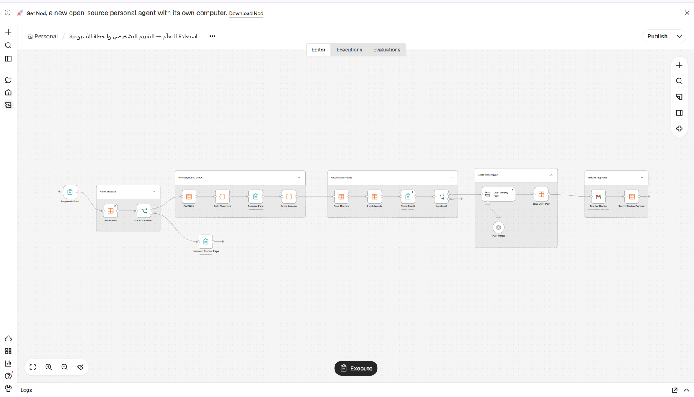

# استعادة التعلّم: مسار يتكيّف مع تقدّم الطالب

ثلاثة Workflows في n8n تساعد المعلم على تحديد فجوات المهارات، تجهيز خطة أسبوعية للمراجعة، تسجيل نتائج التمارين وتحديث مستوى الإتقان، ثم تلخيص تقدّم المجموعة. صُممت لتناسب إدخال نتائج الأوراق المطبوعة عند عودة الاتصال، لا لتتطلب اتصالًا دائمًا من الطالب.

## ماذا تفعل؟

1. **التقييم والخطة:** يتحقق من رمز الطالب وموافقة ولي الأمر، يعرض أسئلة مأخوذة من خريطة المهارات، ويحسب الإجابات. عند وجود فجوات، ينشئ الذكاء الاصطناعي مسودة خطة أسبوعية للمعلم للمراجعة والاعتماد.
2. **تسجيل التمارين:** يسجل المعلم أو الطالب نتيجة تمرين لمهارة واحدة، ويحدّث الإتقان بالمعادلة `60% من الإتقان السابق + 40% من النتيجة الجديدة`. يحدد الخطوة التالية وينبه المعلم عند تكرار النتائج المنخفضة.
3. **التقرير الأسبوعي:** كل خميس الساعة 3 عصرًا، يرسل للمعلم ملخص المحاولات والخطط وحالات الإتقان والفجوات المشتركة للمجموعة.

## المتطلبات

- n8n مع دعم Form Trigger وData Tables وSchedule Trigger وCode وAI Chain.
- بيانات اعتماد OpenAI وGmail.
- خمس جداول n8n: `rl_students` و`rl_skill_map` و`rl_mastery` و`rl_attempts` و`rl_plans`.

## الإعداد

1. استورد [`workflow.json`](./workflow.json)، و[`exercise-update-workflow.json`](./exercise-update-workflow.json)، و[`weekly-report-workflow.json`](./weekly-report-workflow.json) كـ Workflows منفصلة.
2. اربط بيانات اعتماد OpenAI وGmail في كل Workflow يحتاجها.
3. استبدل `YOUR_TEACHER_EMAIL` ببريد المعلم المخوّل في عقد إرسال البريد.
4. أنشئ `rl_students` بالأعمدة `student_code` و`group_code` و`guardian_consent` (Boolean) و`active` (Boolean). استخدم رمزًا مستعارًا فقط، ولا تحفظ أسماء الطلاب أو معلومات اتصالهم في هذا القالب.
5. أنشئ `rl_skill_map` بالأعمدة `skill_code` و`subject` و`skill_name` و`level_order` و`prerequisite_code` و`check_question` و`correct_answer`. أضف خريطة المهارات ومفتاح الإجابة الذي أعده المعلم، واستخدم قيم المادة المطابقة لخيارات الفورم.
6. أنشئ `rl_mastery` بالأعمدة `student_code` و`group_code` و`skill_code` و`subject` و`mastery` و`attempts` و`low_streak` و`status` و`last_updated`.
7. أنشئ `rl_attempts` بالأعمدة `student_code` و`skill_code` و`score` و`attempt_type` و`source` و`attempted_at`.
8. أنشئ `rl_plans` بالأعمدة `student_code` و`subject` و`week_start` و`focus_skills` و`plan_text` و`status` و`reviewed_at`.
9. في عقد Data Table، اختر الجداول التي أنشأتها بدل مراجع الجداول الموجودة في نسخة التصدير. كرر الإعداد في Workflows الثلاثة.
10. اضبط المنطقة الزمنية لكل Workflow على `Asia/Gaza`. قيّد الوصول إلى النماذج والبريد وسجلات الإتقان على الطلاب والمعلمين المخوّلين.

## التشغيل والاختبار

- أضف طالبًا تجريبيًا برمز مستعار وحقلي الموافقة والتفعيل بقيمة `true`، وأضف له مهارات تجريبية في `rl_skill_map`.
- أرسل تقييمًا بإجابة صحيحة وأخرى خاطئة؛ تحقق من حفظ النتائج والفجوات وإنشاء مسودة الخطة عند الحاجة.
- راجع الخطة عبر خطوة الموافقة في البريد، وتأكد من تسجيل حالتها في `rl_plans`؛ لا تُرسل الخطة للطالب تلقائيًا.
- سجّل تمرينًا بنتيجة `100` بعد إتقان سابق `50`، وتحقق من أن الإتقان الجديد `70`.
- شغّل التقرير الأسبوعي يدويًا وتأكد من أن العرض يستخدم الرموز المستعارة ومعلومات المجموعة فقط.
- اختبر طالبًا غير مفعّل أو بلا موافقة، وتأكد من عدم انتقاله إلى مسار التقييم أو تسجيل التمارين.

## الصور والملفات

- [`workflow.json`](./workflow.json): التقييم التشخيصي ومسودة الخطة الأسبوعية.
- [`exercise-update-workflow.json`](./exercise-update-workflow.json): تسجيل التمارين وتحديث الإتقان.
- [`weekly-report-workflow.json`](./weekly-report-workflow.json): التقرير الأسبوعي للمعلم.
- [`screenshots/`](./screenshots/): مخططات Workflows الثلاثة.
- [`caption-ar.txt`](./caption-ar.txt): نص المنشور العربي للمشروع.

> هذا مساعد للمعلم وليس أداة تشخيص أو قرار تربوي. استخدم موافقة ولي الأمر، وقلّل البيانات، وراجع المحتوى المولّد بشريًا قبل استخدامه. نتائج التقييم تخزّن رموزًا مستعارة لكنها تظل بيانات تعليمية ينبغي حمايتها.
