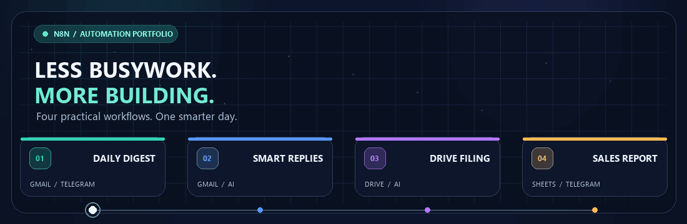
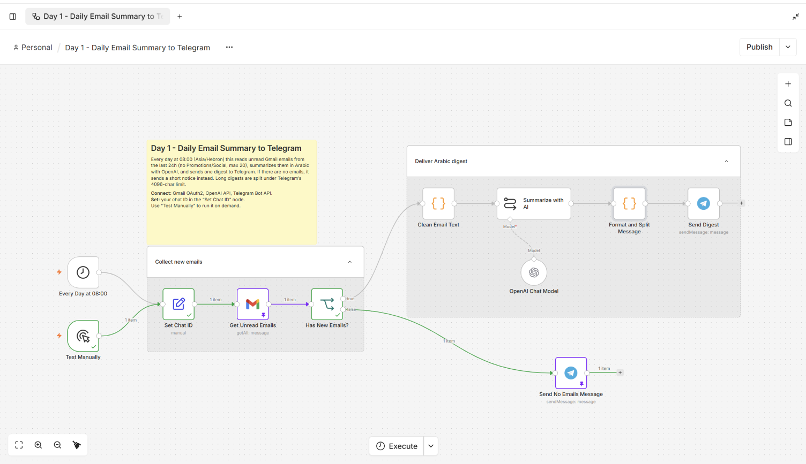
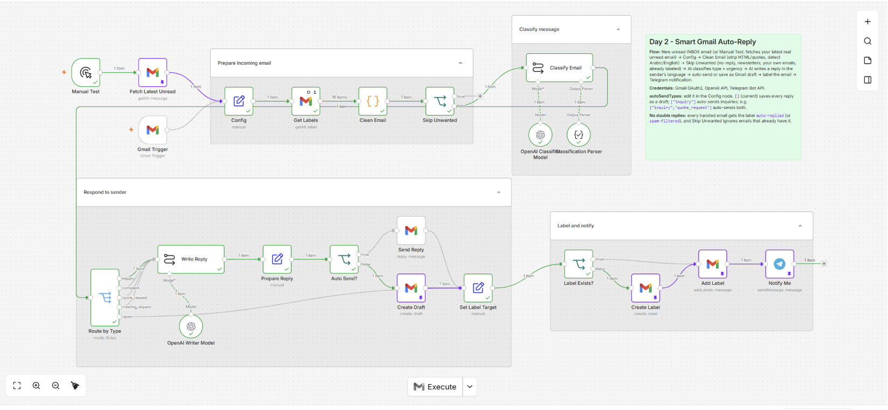
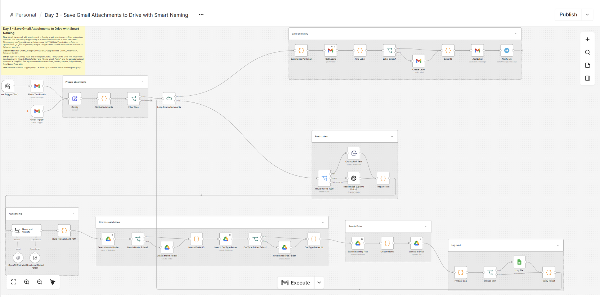
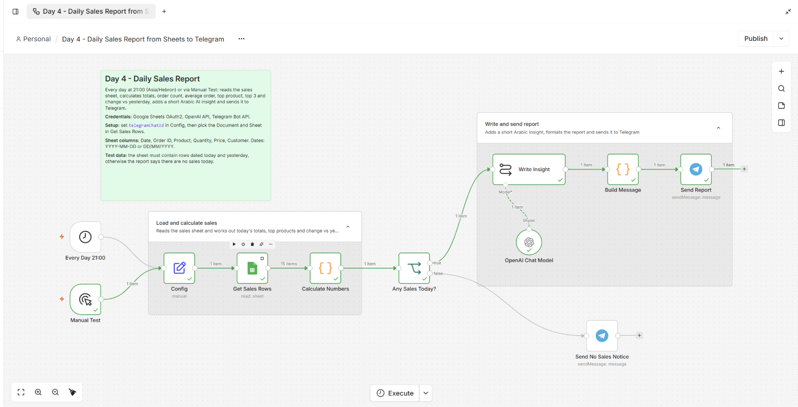

<div align="center">



# n8n Automation Portfolio

### أتمتة عملية، خطوة بخطوة

أربع workflows جاهزة لـ **n8n** تساعدك على تنظيم البريد، التعامل مع المرفقات، وإيصال التقارير إلى Telegram — مع شرح وصور وطريقة استخدام لكل مشروع.

<p>
  
  
  
</p>

<a href="#المشاريع">استكشف المشاريع</a> ·
<a href="#البدء-السريع">البدء السريع</a> ·
<a href="#ملاحظات-مهمة">ملاحظات مهمة</a>

</div>

---

## المشاريع

| # | المشروع | النتيجة | التفاصيل |
|---|---|---|---|
| **01** | **ملخص Gmail اليومي** | ملخص عربي للرسائل المهمة يصلك على Telegram كل صباح. | [شرح المشروع والصور ←](./01-email-digest-telegram/README.md) |
| **02** | **مساعد الرد الذكي** | يصنّف رسائل Gmail ويكتب ردًا للمراجعة كمسودة قبل الإرسال. | [شرح المشروع والصور ←](./02-smart-gmail-replies/README.md) |
| **03** | **منظّم مرفقات Gmail** | يصنّف المرفقات ويسميها ويحفظها في مجلدات مرتبة على Google Drive. | [شرح المشروع والصور ←](./03-gmail-attachments-to-drive/README.md) |
| **04** | **تقرير المبيعات اليومي** | يحلل بيانات Google Sheets ويرسل ملخص الأداء إلى Telegram. | [شرح المشروع والصور ←](./04-daily-sales-report/README.md) |

كل صفحة مشروع تشرح الفكرة، المتطلبات، الإعداد، التشغيل والاختبار، وتعرض لقطات من workflow والنتيجة.

## لمحة من المشاريع

<table>
  <tr>
    <td align="center"><strong>01 · ملخص البريد</strong><br><a href="./01-email-digest-telegram/README.md"></a></td>
    <td align="center"><strong>02 · الرد الذكي</strong><br><a href="./02-smart-gmail-replies/README.md"></a></td>
  </tr>
  <tr>
    <td align="center"><strong>03 · تنظيم المرفقات</strong><br><a href="./03-gmail-attachments-to-drive/README.md"></a></td>
    <td align="center"><strong>04 · تقرير المبيعات</strong><br><a href="./04-daily-sales-report/README.md"></a></td>
  </tr>
</table>

## البدء السريع

### المتطلبات

- نسخة n8n تعمل لديك.
- حسابات وبيانات اعتماد الخدمات التي يستخدمها المشروع: Gmail، Google Sheets، Google Drive، Telegram، وGemini أو OpenAI بحسب الـ workflow.

### استيراد وتشغيل workflow

1. افتح صفحة المشروع المطلوبة من الجدول أعلاه.
2. نزّل ملف `workflow.json` الموجود في مجلدها، ثم استورده إلى n8n.
3. اربط بيانات اعتمادك بالخدمات المطلوبة.
4. راجع عقدة **Config** وأي مراجع لملفات Sheets أو مجلدات Drive.
5. شغّل **Manual Test** واختبره ببيانات مناسبة.
6. بعد التأكد من النتيجة، فعّل التشغيل التلقائي إن رغبت.

## التقنيات

`n8n` · `Gmail` · `Google Drive` · `Google Sheets` · `Telegram` · `OpenAI` · `Gemini`

## هيكل المشروع

```text
.
├── assets/
│   └── automation-showcase.gif
├── 01-email-digest-telegram/
├── 02-smart-gmail-replies/
├── 03-gmail-attachments-to-drive/
└── 04-daily-sales-report/
```

يحتوي كل مجلد مشروع على `README.md` للشرح، و`workflow.json` للاستيراد، و`caption-ar.txt`، ومجلد `screenshots/`.

## ملاحظات مهمة

- ابدأ دائمًا بالاختبار اليدوي قبل تفعيل أي تشغيل تلقائي.
- Workflow الرد على Gmail مضبوط افتراضيًا لحفظ الردود كمسودات. راجع الردود قبل تفعيل الإرسال التلقائي.
- راجع ملفات workflow والصور قبل نشر المستودع للعامة؛ قد تحتوي على أسماء أو عناوين أو معرّفات موارد تخص حساباتك.
- لا تضع مفاتيح API أو كلمات المرور أو ملفات الاعتماد السرية في GitHub.

---

<div align="center">

**بُنيت هذه المشاريع لتكون عملية، قابلة للتجربة، وسهلة التطوير.**

</div>
