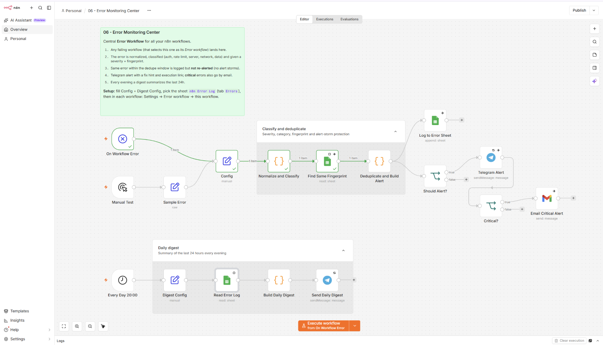
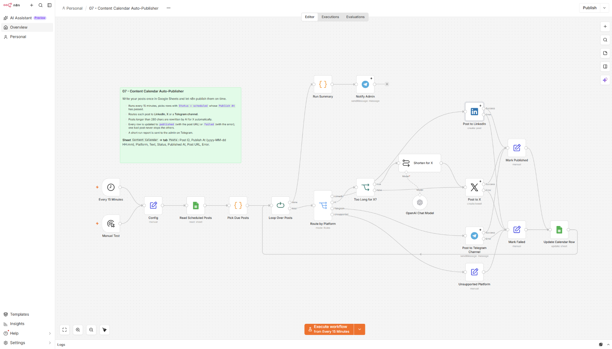
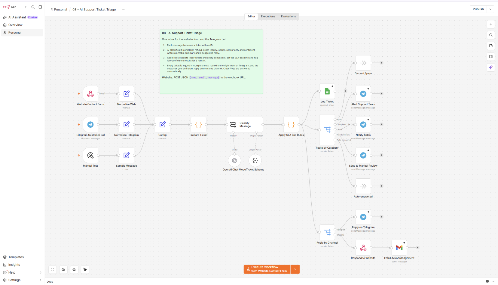
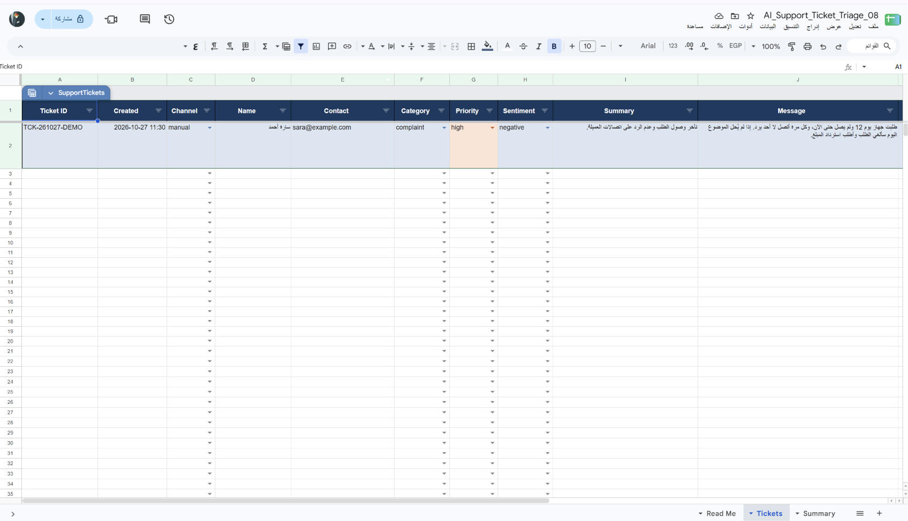
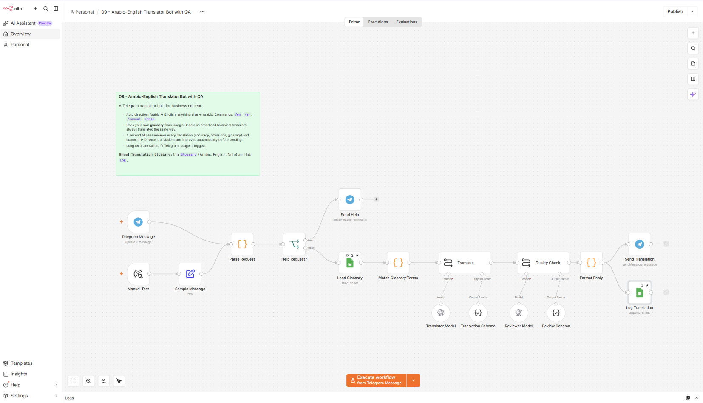
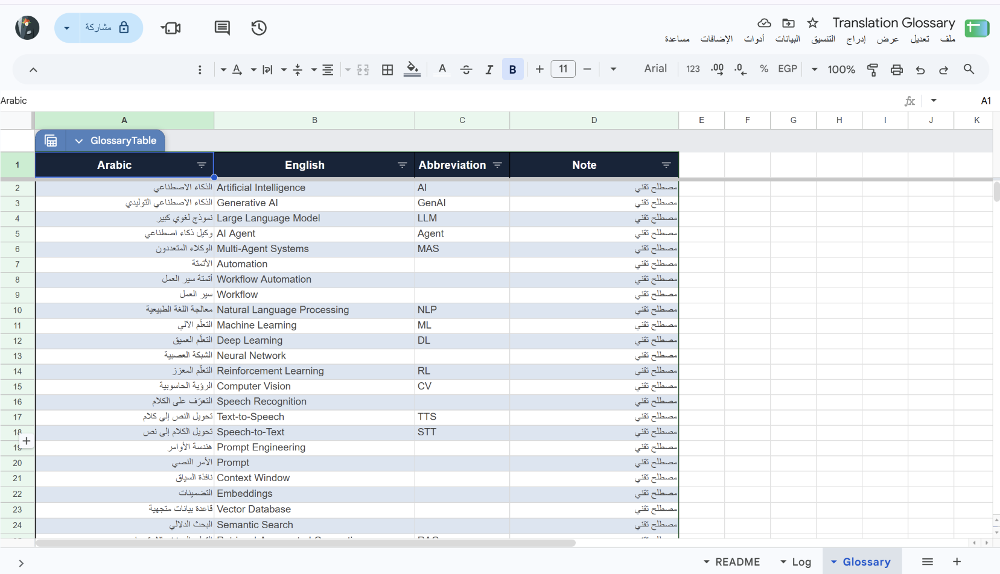
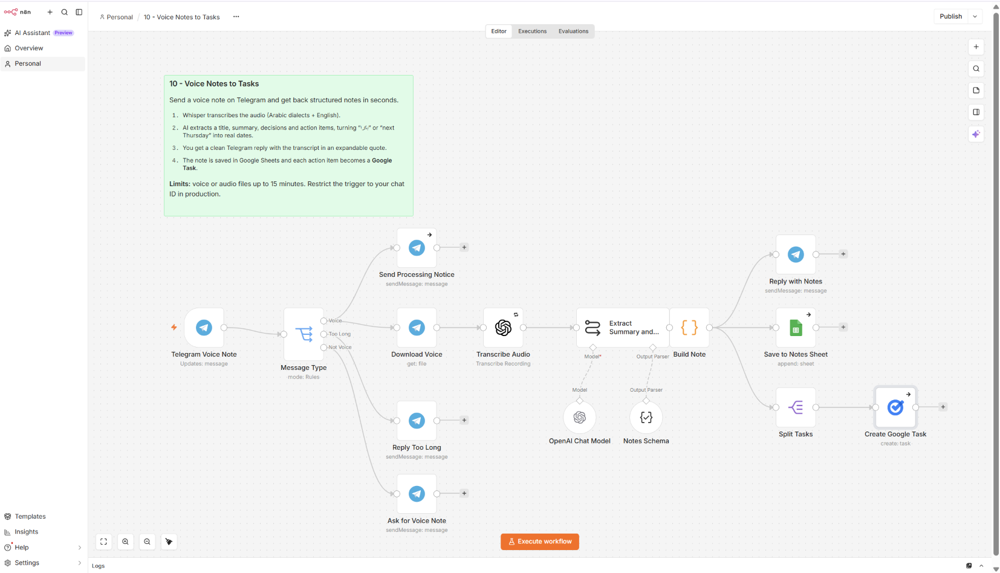
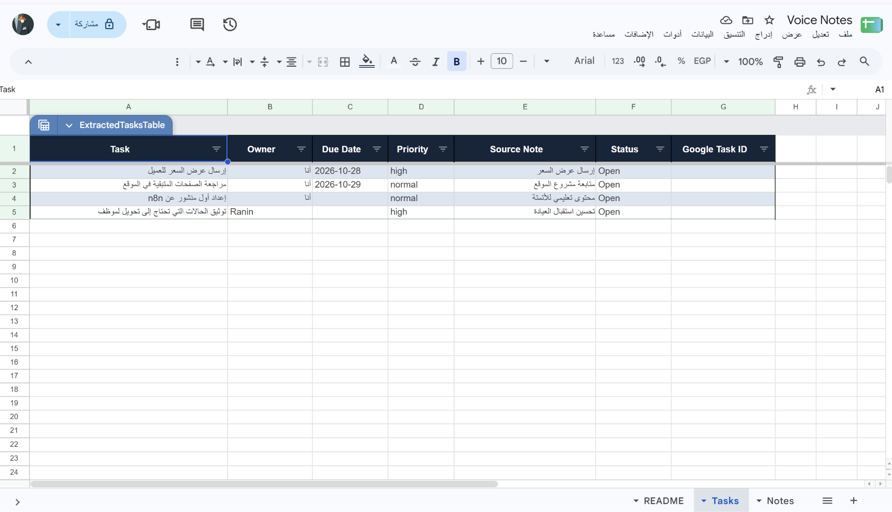

<div align="center">


# n8n Automation Portfolio

### أتمتة عملية، خطوة بخطوة

عشرة workflows جاهزة لـ **n8n** تساعدك على تنظيم البريد، إدارة العملاء، مراقبة الأخطاء، جدولة المحتوى، فرز تذاكر الدعم، الترجمة بمصطلحاتك، وتحويل الصوت إلى مهام — مع شرح وصور وطريقة استخدام لكل مشروع.

<p>
  
  
  
</p>

<a href="#المشاريع">استكشف المشاريع</a> ·
<a href="#البدء-السريع">البدء السريع</a> ·
<a href="#ملاحظات-مهمة">ملاحظات مهمة</a>

</div>

---

## المشاريع

| # | المشروع | النتيجة | التفاصيل |
|---|---|---|---|
| **01** | **ملخص Gmail اليومي** | ملخص عربي للرسائل المهمة يصلك على Telegram كل صباح. | [شرح المشروع والصور ←](./01-email-digest-telegram/README.md) |
| **02** | **مساعد الرد الذكي** | يصنّف رسائل Gmail ويكتب ردًا للمراجعة كمسودة قبل الإرسال. | [شرح المشروع والصور ←](./02-smart-gmail-replies/README.md) |
| **03** | **منظّم مرفقات Gmail** | يصنّف المرفقات ويسميها ويحفظها في مجلدات مرتبة على Google Drive. | [شرح المشروع والصور ←](./03-gmail-attachments-to-drive/README.md) |
| **04** | **تقرير المبيعات اليومي** | يحلل بيانات Google Sheets ويرسل ملخص الأداء إلى Telegram. | [شرح المشروع والصور ←](./04-daily-sales-report/README.md) |
| **05** | **نموذج استقبال العملاء** | يتحقق من الطلبات، يسجل العميل الجديد، ويرسل رسالة ترحيب مع إشعار إلى Telegram. | [شرح المشروع والصور ←](./05-client-intake-welcome-email/README.md) |
| **06** | **مركز مراقبة أخطاء n8n** | يصنّف الأعطال، يمنع تكرار التنبيهات، ويسجلها ويرسل ملخصًا يوميًا. | [شرح المشروع والصور ←](./06-error-monitoring-center/README.md) |
| **07** | **ناشر تقويم المحتوى** | ينشر المنشورات المجدولة على LinkedIn وX وTelegram، ويوثق النتيجة. | [شرح المشروع والصور ←](./07-content-calendar-auto-publisher/README.md) |
| **08** | **فرز تذاكر دعم العملاء** | يجمع رسائل الموقع وTelegram في تذاكر مصنفة وموجهة للفريق المناسب. | [شرح المشروع والصور ←](./08-ai-support-ticket-triage/README.md) |
| **09** | **بوت ترجمة مع مراجعة جودة** | يترجم عبر Telegram باستخدام قاموس مصطلحات مخصص، ثم يراجع الترجمة قبل إرسالها. | [شرح المشروع والصور ←](./09-arabic-english-translator/README.md) |
| **10** | **ملاحظات صوتية إلى مهام** | يفرغ الرسائل الصوتية، يستخرج الملخص والمهام، ويضيفها إلى Google Tasks. | [شرح المشروع والصور ←](./10-voice-notes-to-tasks/README.md) |

كل صفحة مشروع تشرح الفكرة، المتطلبات، الإعداد، التشغيل والاختبار، وتعرض لقطات من workflow والنتيجة.

## لمحة من المشاريع

<table>
  <tr>
    <td align="center"><strong>01 · ملخص البريد</strong><br><a href="./01-email-digest-telegram/README.md"></a></td>
    <td align="center"><strong>02 · الرد الذكي</strong><br><a href="./02-smart-gmail-replies/README.md"></a></td>
  </tr>
  <tr>
    <td align="center"><strong>03 · تنظيم المرفقات</strong><br><a href="./03-gmail-attachments-to-drive/README.md"></a></td>
    <td align="center"><strong>04 · تقرير المبيعات</strong><br><a href="./04-daily-sales-report/README.md"></a></td>
  </tr>
  <tr>
    <td align="center"><strong>05 · تسجيل العملاء والترحيب</strong><br><a href="./05-client-intake-welcome-email/README.md"></a></td>
    <td align="center"><strong>نموذج عربي لاستقبال العملاء</strong><br><a href="./05-client-intake-welcome-email/README.md"></a></td>
  </tr>
  <tr>
    <td align="center"><strong>06 · مراقبة أخطاء n8n</strong><br><a href="./06-error-monitoring-center/README.md"></a></td>
    <td align="center"><strong>07 · نشر تقويم المحتوى</strong><br><a href="./07-content-calendar-auto-publisher/README.md"></a></td>
  </tr>
  <tr>
    <td align="center"><strong>08 · فرز تذاكر الدعم</strong><br><a href="./08-ai-support-ticket-triage/README.md"></a></td>
    <td align="center"><strong>سجل التذاكر وملخصها</strong><br><a href="./08-ai-support-ticket-triage/README.md"></a></td>
  </tr>
  <tr>
    <td align="center"><strong>09 · مترجم Telegram مع فحص الجودة</strong><br><a href="./09-arabic-english-translator/README.md"></a></td>
    <td align="center"><strong>قاموس المصطلحات</strong><br><a href="./09-arabic-english-translator/README.md"></a></td>
  </tr>
  <tr>
    <td align="center"><strong>10 · الملاحظات الصوتية إلى مهام</strong><br><a href="./10-voice-notes-to-tasks/README.md"></a></td>
    <td align="center"><strong>المهام في Google Tasks</strong><br><a href="./10-voice-notes-to-tasks/README.md"></a></td>
  </tr>
</table>

## البدء السريع

### المتطلبات

- نسخة n8n تعمل لديك.
- حسابات وبيانات اعتماد الخدمات التي يستخدمها المشروع: Gmail، Google Sheets، Google Drive، Telegram، وGemini أو OpenAI بحسب الـ workflow.

### استيراد وتشغيل workflow

1. افتح صفحة المشروع المطلوبة من الجدول أعلاه.
2. نزّل ملف `workflow.json` الموجود في مجلدها، ثم استورده إلى n8n.
3. اربط بيانات اعتمادك بالخدمات المطلوبة.
4. راجع عقدة **Config** وأي مراجع لملفات Sheets أو مجلدات Drive.
5. شغّل **Manual Test** واختبره ببيانات مناسبة.
6. بعد التأكد من النتيجة، فعّل التشغيل التلقائي إن رغبت.

## التقنيات

`n8n` · `Gmail` · `Google Drive` · `Google Sheets` · `Google Tasks` · `Telegram` · `LinkedIn` · `X` · `OpenAI` · `Gemini`

## هيكل المشروع

```text
.
├── assets/
│   └── automation-showcase.gif
├── 01-email-digest-telegram/
├── 02-smart-gmail-replies/
├── 03-gmail-attachments-to-drive/
├── 04-daily-sales-report/
├── 05-client-intake-welcome-email/
├── 06-error-monitoring-center/
├── 07-content-calendar-auto-publisher/
├── 08-ai-support-ticket-triage/
├── 09-arabic-english-translator/
└── 10-voice-notes-to-tasks/
```

يحتوي كل مجلد مشروع على `README.md` للشرح، و`workflow.json` للاستيراد، و`caption-ar.txt`، ومجلد `screenshots/`. وتوجد ملفات الجداول التجريبية أو القوالب في `templates/` داخل المشاريع التي تحتاجها.

## ملاحظات مهمة

- ابدأ دائمًا بالاختبار اليدوي قبل تفعيل أي تشغيل تلقائي.
- Workflow الرد على Gmail مضبوط افتراضيًا لحفظ الردود كمسودات. راجع الردود قبل تفعيل الإرسال التلقائي.
- مشروع استقبال العملاء يرسل تفاصيل الطلب إلى Telegram، وقد يرسل بيانات الإدخال الخام عند فشل التحقق. استخدم محادثة خاصة وراجع بيانات الاختبار قبل النشر.
- اختبر ناشر المحتوى بحسابات وقنوات مخصصة؛ التشغيل اليدوي قد ينشر فعليًا على المنصة.
- مشروع فرز التذاكر يرسل رسائل العملاء إلى OpenAI وGoogle Sheets وTelegram. عطّل الرد الآلي أولًا، واستخدم قنوات وجداول خاصة.
- مشروع الترجمة يرسل النصوص إلى OpenAI للترجمة والمراجعة؛ لا ترسل معلومات سرية. سجل الاستخدام لا يحتفظ بنص الترجمة.
- مشروع الملاحظات الصوتية يرسل الصوت إلى OpenAI، ويحفظ نص التفريغ الكامل في Google Sheets ويرسله مرة أخرى عبر Telegram. قيّد البوت بمعرّف محادثتك ولا تستخدمه لمحتوى حساس.
- راجع ملفات workflow والصور قبل نشر المستودع للعامة؛ قد تحتوي على أسماء أو عناوين أو معرّفات موارد تخص حساباتك.
- لا تضع مفاتيح API أو كلمات المرور أو ملفات الاعتماد السرية في GitHub.

---

<div align="center">

**بُنيت هذه المشاريع لتكون عملية، قابلة للتجربة، وسهلة التطوير.**

</div>
